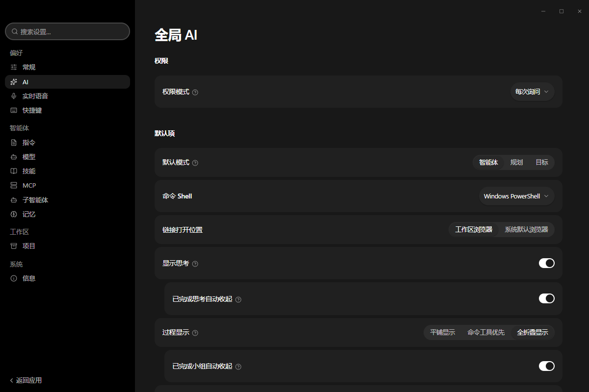

# Pi-Workspace 使用手册（v0.21.0 / Windows）

## Pi-Workspace 是什么

**Pi-Workspace 是一款面向 AI Agent 的模块化桌面工作台**。
它不绑定某个 IDE、某个终端，也不绑定某一家模型厂商，而是给 Agent 一个**长期存在、可扩展的独立工作空间**——
项目、会话、插件、模型、工作面板、定时任务都在同一个桌面应用里持续存在。

本手册面向使用者：安装、界面、设置与排障。构建、打包与二次开发不在本手册范围内。

一句话定位：**不是「某个模型的套壳」，也不是「某个 IDE 的插件」，而是 Agent 工作流的桌面平台。**


---

## 核心特性总览

### 1. 独立的持久化工作区（Project → Session → Agent → Work）

围绕「项目 → 会话 → Agent → 工作」组织，而不是一次性聊天窗口。

- 多项目、多会话并行管理，可固定、归档、分支、搜索会话
- **会话可跨多次启动继续**；流式检查点保留进度，中断后尽可能恢复
- 支持 `@` 引用项目文件、斜杠命令、Agent 运行中排队新指令
- 内置 Diff 审查、命令输出查看、右侧工作面板（Work Panel）

### 2. 三种工作模式：Agent / Plan / Goal

| 模式 | 含义 | 适用场景 |
| --- | --- | --- |
| **Agent** | 给任务直接干活：读代码、改文件、跑命令、测试、迭代 | 日常开发 |
| **Plan** | 先研究项目、产出实施计划，你审完再执行 | 重构、高风险改动 |
| **Goal** | 锁定目标与验收标准，让 Agent 自己选路径推进 | 复杂、长周期任务 |

特权操作一律经过权限层，由你决定每个会话的自主程度。

### 3. 多级 Agent 编排（Subagents + Session Orchestrator）

- **子智能体（Subagents）**：把独立工作委派给后台 Agent（代码探查、实现、测试分析、评审），
  各自独立上下文，结果回传父 Agent。内置 5 个：探索者、代码审查员、测试执行者、修复者、UI 设计师。
- **会话编排（Worker Sessions）**：长周期工作拆给多个**完整会话**并行推进（前端 / 后端 / 测试 / 评审），
  每个 Worker 都是可检视、可复用、带完整 transcript 的真实会话。

### 4. 模型自由（Model-Agnostic）

- 支持 OpenAI、Anthropic、OpenAI 兼容 API、自定义网关、Ollama、LM Studio、本地模型
- 每个模型独立配置：Provider、Model ID、上下文窗口、输出上限、推理档位、温度、OAuth / API Key、Endpoint
- **同一会话随时切换模型**：规划用 A、编码用 B、评审用 C、隐私任务走本地模型
- 内置 models.dev 目录快照（8893 个模型），可一键刷新

### 5. 插件即工作区的一部分（Plugin-Powered）

插件不止扩展 Agent，也扩展桌面本身。可提供：

`Command`（全局命令）、`Panel`（独立界面）、`Floating Widget`（悬浮挂件）、
`Work Panel View`（右侧新视图）、`Agent Tool`（Agent 可调用工具）、`Completion`（复用已配模型）、
`Skill`（技能）、`Theme`（主题）、`MCP Server`（本地 / 远程 MCP）、`Service`（常驻后台服务）、
`Message Bus`（插件间通信）。

可分发布为 `.piplug` 包，也可从插件市场安装。内置 48 个插件，默认全部启用。

### 6. 技能 / MCP / 记忆 / 子智能体 四件套

- **技能**：内置 + 全局 `~/.agents/skills` + 项目级 `<项目>/.agents/skills`，可导入导出、从其他工具扫描
- **MCP**：全局 `~/.agents/servers` 与项目级 `<项目>/.agents/servers`，支持扫描、新增、市场
- **记忆**：Agent 工作中自动写入，可按 全局 / 项目 / 会话 筛选、置顶、清理
- **子智能体**：可自定义提示词与工具白名单

### 7. 定时任务、生成式 UI 与产物清单

- **定时任务**：应用运行时按计划自动执行 Agent 任务
- **生成式 UI**：Agent 可在会话中直接渲染交互式卡片与可视化组件
- **产物文件**：会话写入或修改过的文件自动汇总成可点击清单

### 8. 本地优先 + 权限可控

| 数据 | 默认行为 |
| --- | --- |
| 项目 / 会话 / 设置 / 日志 | 全部本地 |
| API 凭证 | 操作系统钥匙串 |
| 遥测 | 无 |
| 模型请求 | 直连你配置的服务商 |

- **无强制账号、无强制中转**；使用远程模型时，请求所需上下文直接发往该服务商
- 权限层：`Agent → 工具请求 → 权限层 → 允许 / 询问 / 拒绝 → 执行`，可设为「每次询问」
- 界面进程与本地存储服务分离，界面不能绕过存储层直接改数据；插件按声明的权限边界运行

### 9. 迁移友好 + 三平台发布

- 可从 `Claude Code`、`Codex`、`OpenCode`、`Pi` 导入本地会话，不用推倒重来
- 本次交付为 Windows x64（安装包 / 免安装 ZIP）；其他平台的构建另行提供

> 核心只提供地基，**插件决定你的工作区长成什么样**：AI 开发工作台、语音助手、DevOps 控制台、
> GitHub 工作区、数据分析助手、多 Agent 控制中心、自动化平台……都由扩展组合而成。

---

## 本版本速览

| 项目 | 值 |
| --- | --- |
| 产品名 | Pi-Workspace |
| 版本 | 0.21.0 |
| 平台 | Windows x64 |
| 内置插件 | 48 个（默认全部启用） |
| 内置子智能体 | 5 个 |
| 模型目录 | 内置快照 8893 个模型 |
| 安装包 | `Pi-Workspace-Setup-0.21.0.exe`（安装到本机，含开始菜单快捷方式） |
| 免安装包 | `Pi-Workspace-Portable-0.21.0.zip`（解压即用，不写注册表） |
| 适用系统 | Windows 10 / 11 x64 |

---

## 目录

1. [安装与卸载](#1-安装与卸载)
2. [首次启动与界面总览](#2-首次启动与界面总览)
3. [数据目录与存储](#3-数据目录与存储)
4. [设置逐页说明](#4-设置逐页说明)
5. [其它页面：产物文件 / 工具 / 扩展 / 定时任务](#5-其它页面产物文件--工具--扩展--定时任务)
6. [故障排查](#6-故障排查)

---

## 1. 安装与卸载

### 1.1 安装（安装包）

1. 双击 `Pi-Workspace-Setup-0.21.0.exe`。
2. 安装向导可自由选择安装目录。
3. 安装完成后在开始菜单出现「Pi-Workspace」快捷方式，默认安装目录下主程序为 `Pi-Workspace.exe`。
4. 首次启动会解出运行时并创建数据目录（见第 3 节），启动时会出现启动动画，可在设置里关闭或缩短。

### 1.2 免安装（ZIP）

1. 解压 `Pi-Workspace-Portable-0.21.0.zip` 到任意目录（路径尽量不含中文与空格）。
2. 双击 `Pi-Workspace.exe` 即可运行，配置与数据仍写入用户数据目录。

### 1.3 卸载

- 从「设置 → 应用 → 已安装的应用」卸载，或运行安装目录下的 `Uninstall Pi-Workspace.exe`。
- 卸载默认不删除用户数据目录；若要彻底清理，请手动删除第 3 节列出的数据目录。

---

## 2. 首次启动与界面总览

### 2.1 主界面


窗口分三个区域：

- **左侧栏**：`产物文件`、`工具`、`会话`（临时对话）、`项目`（含「打开项目」按钮）。
- **中间会话区**：空态标题「今天想在 <项目名> 里做点什么?」，底部为输入框。
- **底部状态栏**：`设置`、`扩展`、`定时任务`、`通知`，右侧显示当前项目名与版本号 `v0.21.0`。

### 2.2 左侧栏细节


- `产物文件`：Agent 在会话中写入或修改过的文件汇总。
- `工具`：随应用内置的工具包列表。
- `会话`：临时对话（不属于任何项目）。
- `项目`：按项目组织的会话树，`•` 标记表示该项目正在运行任务。

### 2.3 输入框（Composer）


从左到右：

| 控件 | 作用 |
| --- | --- |
| `+` | 添加附件/上下文 |
| `智能体` | 选择当前使用的 Agent 或子智能体 |
| `每次询问` | 权限模式（每次询问工具调用 / 更宽松的模式） |
| `File Explorer` | 选择工具集（本机文件浏览器等） |
| `模型` | 选择模型服务与模型 |
| 折线图标 / 发送箭头 | 发送消息（`Enter` 发送，`Shift+Enter` 换行） |

### 2.4 空态提示


首次进入项目时提示「今天想在 <项目名> 里做点什么?」，输入第一句话即可新建会话。

### 2.5 项目会话页


进入项目后，顶部标题为 `<项目名> / 新建任务`，右上角依次是：侧边面板、搜索、切换侧边栏、最小化/最大化/关闭。
左侧项目树会展开当前项目的会话列表。

---

## 3. 数据目录与存储

Pi-Workspace 的持久数据（会话数据库、日志、插件状态、Agent 指令）默认位于当前用户目录下的
`%LOCALAPPDATA%\PiWorkspace`。需要换盘或做统一部署时，走
**设置 → 常规 → 存储 → 更改路径…**：应用会把已有数据整体搬到新位置，重启后生效。

典型结构：

```text
<数据根>/
  data/           SQLite 数据库、会话记录
  userdata/       渲染层用户数据
  agent/AGENTS.md 全局 Agent 指令文件（见 4.8）
  tools/state.json 工具包启用状态（disabled 列表）
```

清理缓存：**设置 → 常规 → 存储 → 清理缓存…**，按钮旁会显示可清理的体积。

---

## 4. 设置逐页说明

打开方式：左下角齿轮，或 `Ctrl+, `。设置分四组：`偏好`、`智能体`、`工作区`、`系统`。

### 4.1 常规（偏好 → 常规）


| 分区 | 选项 | 说明 |
| --- | --- | --- |
| 外观 | 主题 | 深色 / 浅色 / 跟随系统 |
| | 语言 | 界面语言，默认「跟随系统」 |
| | 字体 | 界面字体，默认「跟随系统」 |
| | 字体大小 | `中杯`/`大杯`/`超大杯`/`超超大杯` + 滑杆微调（100%） |
| | 启动动画 | 开关；打开后可「打开 startup 文件夹」自定义启动视频 |
| | 就绪后提前结束 | 打开后启动动画在应用就绪时立即结束 |
| 侧边栏 | 在项目上显示运行状态 | 项目节点旁显示运行指示 |
| | 数量徽标、活动流光、会话时间、定时任务、环形右键菜单… | 控制侧边栏各项装饰与功能 |
| 网络 | 代理 | 系统 / 直连 / 自定义 |
| | 网络宽松模式 | 放宽网络限制（内网、自签证书等场景） |
| 存储 | 数据保存路径 | 显示当前数据目录，可「更改路径…」 |
| | 可清理缓存 | 显示可回收体积，可「清理缓存…」 |
| 电源 | 保持电脑唤醒 / 阻止屏幕休眠 | 任务运行期间阻止休眠 |
| | 关闭行为 | `关闭到托盘` / `退出应用` |

### 4.2 全局 AI（偏好 → AI）



| 选项 | 取值 | 说明 |
| --- | --- | --- |
| 权限模式 | 每次询问 / 更宽松 | 工具调用前的授权策略 |
| 默认模式 | 智能体 / 规划 / 目标 | 新会话默认使用的运行模式 |
| 命令 Shell | Windows PowerShell 等 | Agent 执行命令使用的 shell |
| 链接打开位置 | 工作区浏览器 / 系统默认浏览器 | 会话内点开链接的去向 |
| 显示思考 | 开 / 关 | 是否展示模型思考过程 |
| 已完成思考自动收起 | 开 / 关 | 思考结束后收起 |
| 过程显示 | 平铺显示 / 命令工具优先 / 全折叠显示 | 工具调用过程的呈现方式 |
| 已完成小组自动收起 | 开 / 关 | 工具小组完成后折叠 |

### 4.3 模型（智能体 → 模型）


首次使用为空态「还没有 AI 服务」。三条接入路径：

1. `+ 添加服务`：手工填写 OpenAI 兼容的 Base URL、API Key 与模型名（支持本地 Ollama、局域网网关）。
2. `从其他工具导入`：扫描本机已有的工具配置并导入。
3. `更新模型目录`：刷新内置的 models.dev 快照。

> **必须至少配置一个可用服务，否则发送消息时无法选择模型。**

### 4.4 技能（智能体 → 技能）


- `自我改进回顾`：让 Agent 在任务后回顾并沉淀技能。
- 三个层级：
  - **内置**（3 个）：`imagen`、`visualize`、`Pi-Workspace plugin development`
  - **全局级** `~/.agents/skills`
  - **项目级** `<项目>/.agents/skills`
- 顶部按钮：`从其他工具扫描`、`+ 新建`、`市场`；每个层级有 `导出文件`/`导入文件`/`导入目录`。
- 每行右侧开关控制该技能是否启用。

### 4.5 MCP（智能体 → MCP）


- 全局级目录 `~/.agents/servers`，项目级目录 `<项目>/.agents/servers`。
- 顶部：`从其他工具扫描`、`+ 新增`、`市场`；筛选为 `全部 / 全局 / 项目`。
- 空态提示「此目录中没有 MCP 服务器」。

### 4.6 子智能体（智能体 → 子智能体）


内置 5 个，均可在右侧开关启停：

| 名称 | 标识 | 用途 | 工具 |
| --- | --- | --- | --- |
| 探索者 | `Task(explorer)` | 快速检索代码、定位实现 | Read / Glob / Grep / Bash |
| 代码审查员 | `Task(code-reviewer)` | 复审代码缺陷、边界与测试缺口 | Read / Glob / Grep |
| 测试执行者 | `Task(test-runner)` | 跑测试/构建并解释失败原因 | Read / Glob / Grep / Bash |
| 修复者 | `Task(fixer)` | 按规格实现跨文件改动 | Read / Glob / Grep / Edit / Write / Bash |
| UI 设计师 | `Task(ui-designer)` | 实现 Web 界面与交互状态 | Read / Glob / Grep / BrowserPreview / Bash / Edit / Write |

`+ 新建子智能体` 可自定义提示词与工具白名单。

### 4.7 记忆（智能体 → 记忆）


- 顶部统计：`活跃 0 · 置顶 0 · 共 0`，右上角 `清理`。
- 筛选：`全部 / 全局 / 项目 / 会话`，支持搜索。
- 空态提示「还没有记忆。Agent 工作时会自己写入，你也可以置顶一条。」

### 4.8 指令（智能体 → 指令）


- 全局指令文件路径显示在文本框上方（如 `D:\\PiWorkspace\\pi\\agent\\AGENTS.md`）。
- 在文本框里写长期生效的指令（编码规范、语言偏好、禁改文件等），点 `保存指令` 写入磁盘。
- 项目级指令请在项目根目录放置 `AGENTS.md`。

### 4.9 快捷键（偏好 → 快捷键）


| 动作 | 默认键 |
| --- | --- |
| 后退 | `Ctrl+[` |
| 前进 | `Ctrl+]` |
| 新建任务 | `Ctrl+N` |
| 打开项目 | `Ctrl+O` |
| 打开设置 | `Ctrl+,` |
| 搜索 | `Ctrl+K` |
| 命令面板 | `Ctrl+Shift+P` |
| 会话内查找 | `Ctrl+F` |
| 插件启动器 | `Alt+Space` |
| 切换侧边栏 | `Ctrl+B` |
| 切换侧边面板 | `Ctrl+J` |

每行右侧可清空或录制新按键，页面右上角有「恢复默认」。

### 4.10 项目（工作区 → 项目）


- 排序：`最近` / `名称`；支持搜索项目。
- 统计「全部项目 N」，每行显示项目路径、会话数、最近活动时间。
- 右上角 `+ 添加项目`（等价于左侧栏「打开项目」）。

### 4.11 信息（系统 → 信息）

| 项 | 内容 |
| --- | --- |
| 产品 | Pi-Workspace |
| 版本 | 0.21.0 |
| 日志 | `打开日志`：直接打开日志目录，排障首选 |
| 开发者模式 | 开关，打开后暴露开发相关入口（控制台、开发者工具等） |

> 本页只显示产品名、版本号与日志入口，不包含任何外部链接。

---

## 5. 其它页面：产物文件 / 工具 / 扩展 / 定时任务

### 5.1 产物文件


会话中 Agent 写入或修改过的文件会汇总到此页，点击可直接打开。
空态文案：「还没有文件 / 会话写入或修改过的文件会出现在这里。」

### 5.2 工具（工具包 + 挂件）


工具页上下两块，**来源不同、生命周期也不同**：

| 区块 | 来源 | 由谁执行 |
| --- | --- | --- |
| 上方：挂件 | `<数据目录>/widgets/<文件夹>/`，用户自己放进去 | Agent sidecar 进程 |
| 下方：工具包 | `<安装目录>/resources/tools`，随应用内置 | 声明式元数据，不执行代码 |

截图里上方那张卡片就是示例挂件 `tide-probe`：

- 标题行：名称 `Tide probe` + 版本 `0.1.0` + `未信任` 徽章 + 右侧启用开关。
- `权限`：已授予 `read`，申请中的 `host` 用红框标出——**申请不等于授予**。
- `运行状态`：未加载（未信任的包默认不加载）。
- 每个声明的 action 占一行，右侧有独立 `运行` 按钮；右下角 `信任并启用` 按钮与包摘要。
- 页面右上角 `打开挂件目录` 直接打开 `<数据目录>/widgets`。

挂件的最小结构：

```text
<数据目录>/widgets/<文件夹>/
  widget.json
  index.mjs        # 也可以是 index.js / index.cjs，解析顺序 js → mjs → cjs
```

> **注意**：`widget.json` 里 `params` 字段的正确写法是**字符串数组**——`"params": []` 表示无参数，
> `"params": ["note"]` 表示有一个名为 note 的参数。写成对象（`"params": {}` 或 `"params": { "note": { ... } }`）
> 会导致挂件报错：`invalid type: map, expected a sequence`，卡片变红并显示「该挂件无法读取」。

挂件 `widget.json` 的正确形态：

```json
{
  "schemaVersion": 1,
  "apiVersion": 1,
  "id": "example.tide-probe",
  "name": "Tide probe",
  "version": "0.1.0",
  "description": "一句话说明这个包干什么。",
  "author": "optional",
  "permissions": ["read", "host"],
  "actions": [
    { "name": "now", "description": "返回当前时间（ISO-8601）。", "params": [] },
    { "name": "remember", "description": "统计记忆条数。", "params": ["note"] }
  ]
}
```

- `id` 是主键；两个文件夹用同一个 id 时，后一个会标记为 `duplicate id`。
- `permissions` 按 `read` → `write` → `net` → `agent` → `host` 递进；未受信任时只保留 `read` / `write`。
- `actions` 是唯一可调用面，模块里注册了但清单没声明的 action 调不到。
- 上限：64 个挂件，每个挂件 512 个文件、8 MB。
- 入口模块必须 **default export 一个 activate 函数**；只写 `module.exports = {...}` 不会加载。
  挂件内改任何一个字节都会改变摘要，信任自动撤销并标记为 `modified`。
- 从挂件里回连宿主只有 5 个方法可用：`memory.recall`、`memory.list`、`memory.stats`、`workspace.get`、`app.health`，且需要 `host` 权限。

下方的工具包来自 `<安装目录>/resources/tools`，每个子目录是一个工具包，需包含 `tool.json`：

```json
{
  "schemaVersion": 1,
  "id": "local.example.package",
  "name": "Example tools",
  "version": "0.1.0",
  "description": "What this package is for, in one line.",
  "author": "optional",
  "tools": [
    { "name": "inspect_widget", "description": "What the tool does, in one line.", "risk": "low" }
  ]
}
```

- `schemaVersion` 必须为 `1`；否则该行会显示为「损坏」而不是被忽略。
- 启用状态保存在 `<数据目录>/tools/state.json` 的 `disabled` 数组里。

### 5.3 扩展（插件）


- 顶部：`已安装 48` / `插件市场`，右上角 `浏览市场`。
- 「已启用 48」说明内置插件默认全开。
- 每张卡片：名称 + `内置` 徽章 + 插件 id + 版本 + `详情` 折叠 + 作用域（`全局`）+ 齿轮（设置）+ `⋯`（更多）。
- 搜索框可按名称过滤已安装插件。

### 5.4 定时任务


- 页面说明：「应用运行时，按计划自动执行 Agent 任务。」
- 右上角 `创建任务`；空态提示「暂无已安排任务」。
- 注意：定时任务只在应用运行时触发。

---

## 6. 故障排查

| 现象 | 原因 | 处理 |
| --- | --- | --- |
| 挂件卡片变红：`widget.json: invalid type: map, expected a sequence at line …` | `params` 写成了对象 | 改成字符串数组：`"params": []` 或 `"params": ["note"]`，见 5.2 |
| 挂件显示 `未信任` 且运行状态 `未加载` | 首次出现或挂件内文件被改过，摘要变了 | 点卡片上的 `信任并启用`；改代码后需要重新信任 |
| 发送消息时无法选择模型 | 未配置任何 AI 服务 | 设置 → 模型 → `+ 添加服务` |
| 想彻底重置应用 | 数据目录残留 | 关闭应用后删除第 3 节的数据目录；或在设置 → 常规 → 存储里先改到新路径 |

排障第一入口：**设置 → 信息 → `打开日志`**。
