# Pi-Workspace 使用手册（v0.21.0 / Windows）

> 本手册对应当前这版客户端（0.21.0，Windows x64）。**已按本版本的实际界面与行为重写**：
> 设置已拆成 14 个目的地、内置提供商 WorkBuddy 随应用运行、模式支持自定义分阶段工作流、
> 已随包的 WorkBuddy 插件退役。文中所有数值、路径、开关名称都取自这一版的实际代码与运行结果。

## Pi-Workspace 是什么

**面向 AI Agent 的模块化桌面工作台**：项目、会话、模式、子智能体、技能、MCP、记忆、插件、
工作面板、定时任务都在同一个桌面应用里持续存在。它不绑定某个 IDE、某个终端，也不绑定某一家模型厂商。

一句话：**不是某个模型的套壳，也不是某个 IDE 的插件，而是 Agent 工作流的桌面平台。**

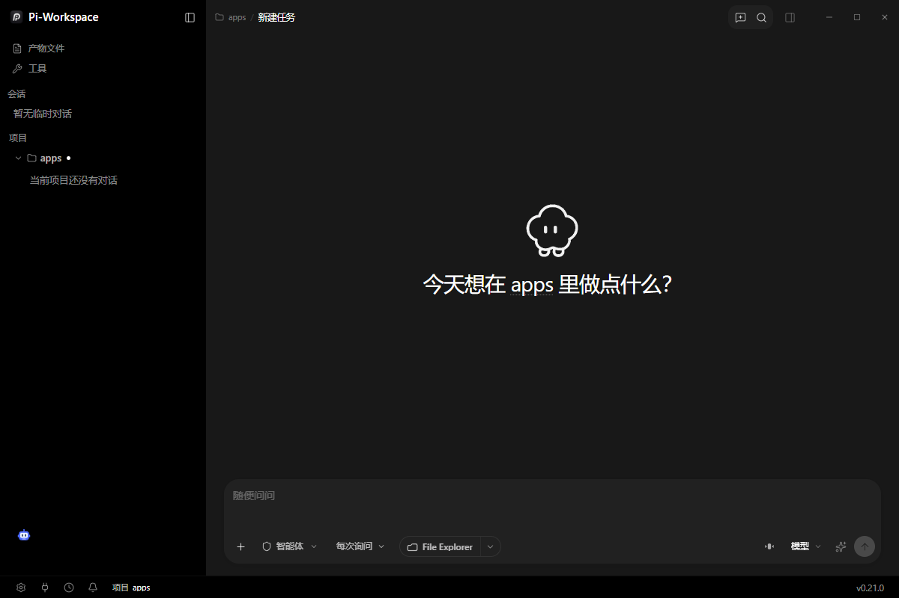

---

## 本版本速览

| 项目 | 值 |
| --- | --- |
| 产品 / 版本 | Pi-Workspace / 0.21.0 |
| 平台 | Windows 10 / 11 x64 |
| 内置插件 | **46 个**（默认全部启用；原 WorkBuddy 插件已退役，见 8.6）|
| 内置子智能体 | **5 个**（探索者、代码审查员、测试执行者、修复者、UI 设计师）|
| 内置技能 | **3 个**（`image-generation`、`plugin-development`、`visualize`）|
| 内置提供商 | **WorkBuddy**（随应用启动的本地网关，无需密钥，17 个模型）|
| 模型目录 | 内置快照 ~8900+ 模型，可一键更新 |
| 运行模式 | 内置 3 个（Agent / Plan / Goal）+ 你自定义的分阶段模式 |
| 安装包 | `Pi-Workspace-Setup-0.21.0.exe`（含开始菜单快捷方式）|
| 免安装 | `Pi-Workspace-Portable-0.21.0.zip`（解压即用）或 `Pi-Workspace-Portable-0.21.0.exe`（单文件）|
| 数据根（安装版/免安装）| `D:\PiWorkspace`（无 D 盘时按 E、F… 顺延；都没有才回落到用户目录）|

---

## 目录

1. [安装、启动与版本形态](#1-安装启动与版本形态)
2. [界面总览](#2-界面总览)
3. [输入区（Composer）详解](#3-输入区composer详解)
4. [模式：从三个内置到自定义分阶段工作流](#4-模式从三个内置到自定义分阶段工作流)
5. [会话与转录](#5-会话与转录)
6. [项目、工作面板与产物](#6-项目工作面板与产物)
7. [智能体能力：子智能体 / 后台任务 / 技能 / MCP / 记忆](#7-智能体能力子智能体--后台任务--技能--mcp--记忆)
8. [模型与提供商](#8-模型与提供商)
9. [插件、挂件与工具包](#9-插件挂件与工具包)
10. [定时任务、通知与电源](#10-定时任务通知与电源)
11. [设置逐页说明（14 个目的地）](#11-设置逐页说明14-个目的地)
12. [快捷键、命令面板与斜杠命令](#12-快捷键命令面板与斜杠命令)
13. [数据、备份与迁移](#13-数据备份与迁移)
14. [故障排查](#14-故障排查)
15. [隐藏用法集锦（25 条）](#15-隐藏用法集锦25-条)

---

## 1. 安装、启动与版本形态

### 1.1 三种形态的区别（**不只是打包方式**）

| 形态 | 文件 | 更新行为 | 任务栏身份 |
| --- | --- | --- | --- |
| 安装版 | `Pi-Workspace-Setup-0.21.0.exe` | 走安装器，可用更新通道 | 认领产品 AppUserModelID（NSIS 自带开始菜单快捷方式）|
| 免安装 ZIP | `Pi-Workspace-Portable-0.21.0.zip` | 只提示新版本并给出下载链接，不自动替换 | **不认领**，用 exe 自身的名字与图标 |
| 单文件便携 | `Pi-Workspace-Portable-0.21.0.exe` | 同上 | 同上 |

> 这条区别有实际后果：**免安装版必须在开始菜单没有"冒用同一个 AppUserModelID 的旧快捷方式"时，
> 任务栏才显示正确的 P 图标与"Pi-Workspace"名字**。如果曾经用开发模式跑过 `electron.exe`，
> 开始菜单可能残留一个名为 `Electron` 的快捷方式，它会把免安装版的任务栏图标改成 Electron 的原子图标。
> 处理见 [14.3](#143-任务栏图标不对或名字显示-electron)。

### 1.2 安装与首次启动

1. 双击 `Pi-Workspace-Setup-0.21.0.exe`，可自选安装目录；完成后开始菜单出现「Pi-Workspace」。
2. 首次启动会解出运行时并创建数据根（见第 13 节），期间有启动动画。
3. 启动动画可在 **设置 → 外观 → 启动动画** 里关闭，或勾「就绪后提前结束」。

### 1.3 卸载

从「设置 → 应用 → 已安装的应用」卸载，或运行安装目录下的 `Uninstall Pi-Workspace.exe`。
**卸载不删数据**；要彻底清理请手动删第 13 节列出的数据根。

---

## 2. 界面总览

### 2.1 三区结构


- **左侧栏**：`产物文件`、`工具`、`会话`、`项目`（含「打开项目」）。
- **中间**：会话区。空态标题「今天想在 <项目名> 里做点什么?」，底部是输入区。


- **右侧工作面板**（`Ctrl+J` 开关）：Diff、文件、浏览器等视图，见 6.2。
- **底部状态栏**：`设置`、`扩展`、`定时任务`、`通知`，右侧是当前项目名与 `v0.21.0`。

### 2.2 左侧栏

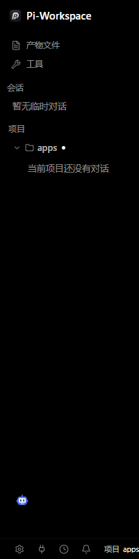

| 区块 | 内容 |
| --- | --- |
| 产物文件 | Agent 在会话里写入/修改过的文件汇总 |
| 工具 | 随包工具包 + 用户挂件 |
| 会话 | 不属于任何项目的临时对话 |
| 项目 | 按项目组织的会话树；`•` 表示该项目正在跑任务 |

侧栏可以在 **设置 → 外观 → 侧栏** 里控制是否显示：运行状态、数量徽标、活动流光、会话时间、定时任务、环形右键菜单。

> **隐藏用法**：在项目节点上**右键**会打开环形（径向）菜单，快速执行新建会话、打开目录等动作；
> 该菜单本身也能在设置里关闭或改四个方向的动作。

### 2.3 顶部窗口控件

进入项目后，顶部标题是 `<项目名> / 新建任务`，右上角依次是：侧边面板、搜索、切换侧边栏、最小化/最大化/关闭。

### 2.4 项目会话页

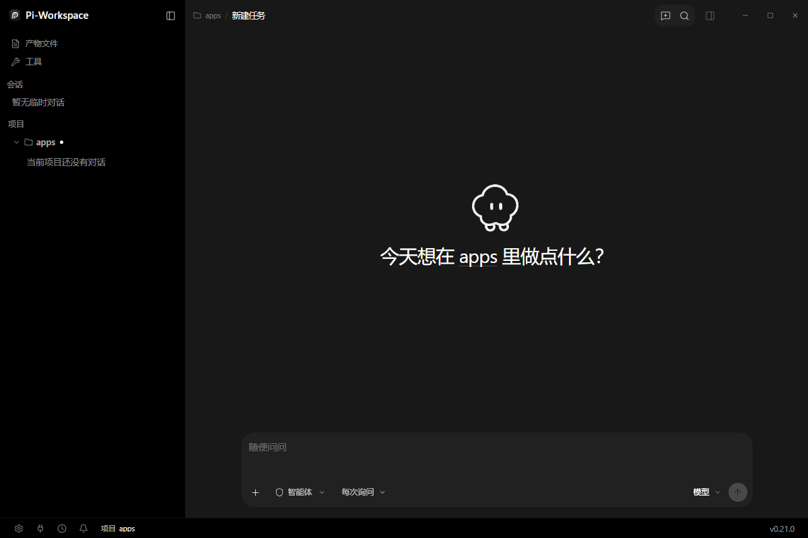

左侧项目树展开当前项目的会话列表；点会话进入转录；右上角按钮与 2.3 相同。

---

## 3. 输入区（Composer）详解


### 3.1 工具栏从左到右

| 控件 | 作用 |
| --- | --- |
| `+` | 添加附件/上下文（文件、图片、粘贴内容）|
| `智能体` | 选择当前 Agent 或子智能体（对应 `@` 提及）|
| 权限模式 | 每次询问 / 自动接受编辑 / 全自动，见 11.4 |
| 工具集 | 例如 `File Explorer`，即当前会话可用的工具面 |
| 模型 | 打开双栏模型选择器，见 8.5 |
| 发送/停止 | 空闲时是发送，运行中变成停止（等价 `Ctrl+.`）|

### 3.2 `@` 提及：三类对象，一条边界规则

输入 `@` 会弹出分组菜单：

1. **文件**（当前项目内文件）；
2. **智能体**（子智能体目录，与 `Task` 工具同源）；
3. **命令**（插件/扩展提供的命令，等价斜杠命令）。

**隐藏规则（重要）**：`@名字` 只有在**词边界**上才被解析，所以 `user@host` 这类文本不会被误判。
另一个关键点是 —— **只有 Agent 模式**会把 `@子智能体` 当成委派；Plan / Goal 模式里手打的 `@` 保持字面文本，
因为这两个模式不允许执行 `Task`。

### 3.3 斜杠命令（`/`）

内置 6 个，直接输入斜杠可见：

| 命令 | 作用 |
| --- | --- |
| `/new` | 新建任务（会话）|
| `/compact` | 压缩当前会话上下文（保留结论，丢弃冗余过程）|
| `/agent-mode` | 切到 Agent 模式 |
| `/plan-mode` | 切到 Plan 模式 |
| `/goal-mode` | 切到 Goal 模式 |
| `/fast` | 切换 Fast 模式（走服务商的加速档位）|

此外还有三类会合并进同一个 `/` 命名空间（重名时内置优先）：

- **插件/扩展命令**：`/<命令名>`；
- **技能**：`/<技能名>`；
- **MCP**：`/mcp:<服务器id>` 打开该服务器的全部工具，`/mcp:<服务器id>:<工具名>` 直接指定工具。

> **隐藏用法**：在输入框里先打 `/` 再打几个字母，是"按名字找能力"最快的方式——
> 它同时检索插件命令、技能、MCP 工具，不用逐个进设置页翻。

### 3.4 附件、粘贴与大段文本

- 支持粘贴图片、粘贴文件（原生剪贴板里的文件会登记成**活引用**：只记录路径与大小，不发文件内容）。
- **大段文本粘贴阈值**（设置 → 对话 → 输入）：超过阈值的粘贴会折叠成附件，避免一次塞爆输入框。
- **回车发送**（设置 → 对话 → 输入）：关掉后 `Enter` 只换行，用 `Ctrl+Enter` 发送。

### 3.5 运行中排队与打断（steering）

Agent 正在跑的时候继续输入，消息会进入队列，而不是被拒绝：

- 队列里的消息会在合适的间隙插入（不必等整轮结束）。
- **打断**当前回合按 `Ctrl+.`（等价于工具栏的停止）。打断的语义是"等本地正在执行的命令/读取落定后再交给模型"，
  未开始的调用会被跳过并释放批次预留；后台命令继续保留。
- 远程工作区调用无法确认落定，因此打断**不会**取消它们，异常情况需要用显式停止。

### 3.6 可视化与图片（默认关的那一项最容易踩）

| 能力 | 怎么开 | 细节 |
| --- | --- | --- |
| 会话内嵌可视化（gen-UI）| 设置 → 对话 → 显示 → `聊天内嵌可视化`（**默认关闭**）| 打开后 Agent 会把交互式 HTML 卡片写进「会话可视化目录」并在转录里渲染；内置 d3 7.9、floating-ui 随包，无需联网。`visualize` 技能**只在这个开关打开时才存在** |
| 生成图片 | 设置 → 模型 → 图片模型 | 与聊天模型分开配置；未配置时 Agent 会明确说没有可用的图片模型 |
| 生成图片的提示规范 | 内置技能 `image-generation` | 直接 `/image-generation` 或让 Agent 调用 |

> **这是最常见的"技能凭空消失"原因**：关掉「聊天内嵌可视化」后，`visualize` 技能从技能列表、`/` 命令、
> 以及历史消息的引用行里一起消失。要它回来，打开这个开关，不用重装。

---

## 4. 模式：从三个内置到自定义分阶段工作流

### 4.1 三个内置模式

| 模式 | 含义 | 能做什么 |
| --- | --- | --- |
| **Agent** | 直接干活 | 读代码、改文件、跑命令、测试、委派子智能体 |
| **Plan** | 先研究再获批 | 产出实施计划，等你审批后才执行；工具受限（不写文件）|
| **Goal** | 锁定目标与验收标准 | 自己选路径推进，适合长周期任务；有预算与检查点 |

新会话的默认模式在 **设置 → 行为 → 会话默认 → 默认模式**。

### 4.2 自定义模式 = 一个 Markdown 文件

位置：`~/.pi/modes/<目录名>/mode.md`（**只做全局发现**，克隆下来的仓库不能自带模式）。
正文是共享系统提示词；`templates/` 里可放产物模板。设置页每次加载都重读目录，所以外部编辑器写完不用重启。

内置 id（`agent` / `plan` / `goal`）**保留**：用户文档撞名会在设置里被报出来且不加载；想改内置就复制成新 id。

**简单模式**（只有提示词 + 权限等级，没有阶段与运行）：

```markdown
---
name: review
label: Review
description: Read-only code review
permission: contract
---
Review the current changes for defects. Do not modify files.
```

**分阶段模式**（有阶段、产物、闸门；发出第一条消息即启动一次 run）：

```markdown
---
name: feature
label: Feature
description: Spec, implement and verify one feature
artifacts:
  spec:
    path: .pi/runs/{{run.id}}/spec.md
    template: templates/spec.md
    requiredHeadings: [Goal, Acceptance criteria]
budget: { maxTurns: 30 }
stages:
  design:
    permission: contract
    prompt: Write the spec for {{run.input}}.
    exit:
      - require: artifact:spec
      - ask: user
    next: implement
  implement:
    permission: agent
    loop: true
    prompt: Implement the approved spec.
    on:
      compaction: [{ inject: artifact:spec }]
    exit:
      - run: pnpm test
        onFail: { retries: 3 }
---
Follow the repository conventions.
```

### 4.3 frontmatter 全字段

| 层级 | 字段 | 含义 | 默认 |
| --- | --- | --- | --- |
| mode | `name` / `label` / `description` | 模式选择器里的身份 | `name` = 目录名 |
| mode | `permission` | `agent` 或 `contract`，阶段继承 | `agent` |
| mode | `artifacts` | `id → { path, template?, requiredHeadings? }` | 无 |
| mode | `budget` | 一次 run 的 `maxTurns` / `maxTokens` | `maxTurns: 20` |
| mode | `returnTo` | run 结束后会话回到哪个模式 | `agent` |
| mode | `stages` | 有序阶段表；第一个阶段启动 run | 无（=简单模式）|
| stage | `prompt` | 该阶段的系统提示段 | 无 |
| stage | `permission` | 覆盖 mode 级 | mode 值 |
| stage | `loop` | 该阶段跨回合继续 | `false` |
| stage | `on` | `enter` / `compaction` → `inject` 列表 | 无 |
| stage | `exit` | 有序闸门 | 无 |
| stage | `next` | 下一个阶段；缺省即终点 | 无 |

变量只有三种：`{{run.id}}`、`{{run.input}}`（启动 run 的那条消息）、`{{artifacts.<id>.path}}`，纯文本替换。

### 4.4 运行语义（决定你怎么写提示词）

- **阶段简报**：每回合 Host 自动往阶段提示里加一段——当前阶段、已声明产物（路径与必填标题）、闸门、如何结束。
  你只写意图，不写这些机械信息。
- **模板**：首次进入某阶段时，缺失的产物会用模板写出来（变量已替换）。
- **结束一个阶段**：模型调用 `CompleteStage { summary, artifacts? }`；`artifacts` 里的 Markdown 由 Host 写到产物路径
  （所以 `contract` 阶段不发 Write 权限也能产出文件）。随后 Host 按顺序评估闸门。
- **闸门失败**：失败会作为下一次输入回到模型；`run:` 类闸门支持 `onFail.retries`。
- **上下文压缩**：`on.compaction` 可以把产物重新注入，避免压缩后忘记规格。

---

## 5. 会话与转录

### 5.1 会话生命周期

- 每个项目下多会话并行；可置顶、归档、搜索、复制/分支。
- 会话跨多次启动继续存在；流式检查点尽量保留中断前的进度。
- `Ctrl+N` 新建任务，`Ctrl+K` 全局搜索，`Ctrl+F` **只在当前会话内查找**。

### 5.2 转录的显示控制（设置 → 对话）

| 开关 | 作用 |
| --- | --- |
| 显示思考 | 展开模型的思考过程 |
| 已完成思考自动收起 | 思考结束后自动折叠 |
| 过程显示 | 平铺 / 命令工具优先 / 全折叠，三档 |
| 已完成小组自动收起 | 工具调用小组结束后折叠 |
| 上下文用量读数 | 显示"已用"或"剩余"|
| 平滑流式显示 | 流式输出平滑化（关掉更接近逐字）|
| 聊天内嵌可视化 | **默认关闭**。打开后 Agent 才能往「会话可视化目录」写交互式 HTML 卡片，`visualize` 技能也才会出现；关着时不仅不渲染，历史里的引用行也一并隐藏 |

### 5.3 转录里的交互

- **文件引用可定位**：消息里的文件引用点一下会打开所在文件夹（不是编辑器）。
- **回到底部/最新**：滚动离开底部后会出现"跳到最新"入口，长回答跟踪有专门实现（不会打断你的上滚）。
- **消息级动作**：复制、引用、在审查面板打开对应改动。
- **成本可见**：单轮与整个会话的花费显示在 usage/积分处（仅对配置了价格的提供商显示）。

### 5.4 计划与目标

- **Plan 模式**：产出的计划会以审批卡出现，你可改、可拒、可批准后再执行。
- **Goal 模式**：锁定目标与验收标准后自行推进；有 turn/token 预算，暂停与恢复都有明确状态。

---

## 6. 项目、工作面板与产物

### 6.1 项目

- 打开项目：左上「打开项目」或 `Ctrl+O`；项目清单在 **设置 → 项目**（可按最近/名称排序、搜索、添加）。
- 项目根目录的 `AGENTS.md` 是**项目级指令**，与全局指令叠加。
- 会话/项目元数据都在本地数据库里，不上传。

### 6.2 右侧工作面板（`Ctrl+J`）

右侧面板是可开多个标签的工作区，常见视图：

- **Review / Diff**：逐文件看 Agent 的改动，可按块处理；
- **文件**：项目内文件浏览与搜索；
- **浏览器**：工作区内置浏览器（链接打开位置可设为它或系统浏览器）；
- **文件管理器视图**、**生成式 UI 预览**等由插件提供。

标签可拖动、可关闭、可重排；面板宽度会记住。

> **隐藏用法**：`Ctrl+J` 打开的是上一次的工作面板布局；把经常一起看的视图钉在同一个面板里，比反复开侧栏快得多。

### 6.3 产物文件

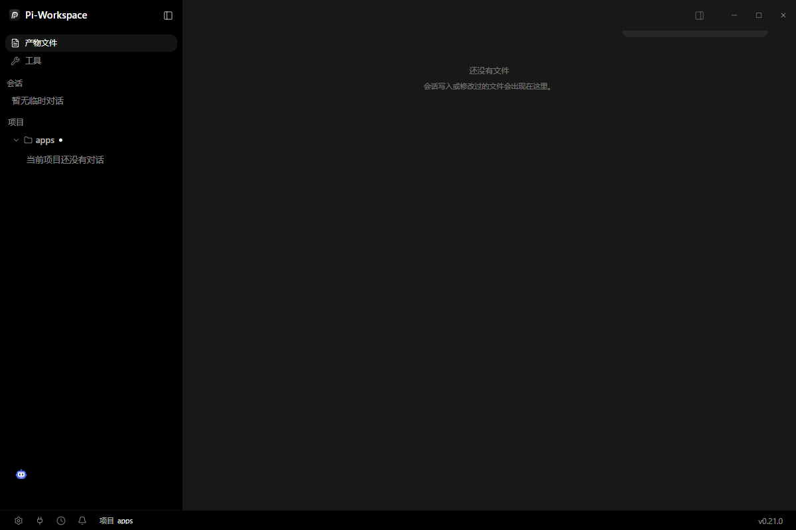

会话写入/修改过的文件汇总在左栏「产物文件」，点击可直接打开。
空态文案：`还没有文件 / 会话写入或修改过的文件会出现在这里。`

---

## 7. 智能体能力：子智能体 / 后台任务 / 技能 / MCP / 记忆

### 7.1 子智能体（Settings → 子智能体）

内置 5 个预设，都可开关：

| 名称 | 标识 | 用途 | 典型工具 |
| --- | --- | --- | --- |
| 探索者 | `Task(explorer)` | 检索代码库，回答「在哪」「怎么工作」| Read / Glob / Grep / Bash |
| 代码审查员 | `Task(code-reviewer)` | 提交前查正确性、边界、缺测 | Read / Glob / Grep |
| 测试执行者 | `Task(test-runner)` | 跑测试/构建并解释失败 | Read / Glob / Grep / Bash |
| 修复者 | `Task(fixer)` | 按规格做跨文件改动 | Read / Glob / Grep / Edit / Write / Bash |
| UI 设计师 | `Task(ui-designer)` | 按需求实现界面并用浏览器预览验收 | Read / Glob / Grep / BrowserPreview / Bash / Edit / Write |

自定义：`+ 新建子智能体` → 从模板开始（含"空白开始"）。可设提示词、工具白名单（或 `inherit` 继承父会话工具）、
模型（含回退模型链）、思考档位。定义文档上限 **32 KB**。
**子智能体只支持全局级**，没有项目级定义。

调用方式有两种：让主 Agent 自己用 `Task(<id>)` 委派，或在输入框 `@<名字>` 直接指向它（**仅 Agent 模式**）。

### 7.2 后台任务（Bash 后台执行）

三个工具让长命令不阻塞对话：

| 工具 | 作用 |
| --- | --- |
| `TaskList` | 列出当前会话的后台任务与状态 |
| `TaskWait` | 等待某个任务结束（可设超时），等待期间可被打断 |
| `TaskStop` | 停止任务；被取消的等待会立即中断 |

> **隐藏用法**：跑 dev server / 监听日志时用后台任务，再让 Agent 用 `TaskWait` 拿到前 N 行输出判断就绪，
> 比"跑一下等到超时"稳定得多。

### 7.3 技能（Settings → 技能）

三个层级：

| 层级 | 位置 | 说明 |
| --- | --- | --- |
| 内置 | 随应用（3 个：`image-generation`、`plugin-development`、`visualize`）| 不可删除，可停用 |
| 全局 | `~/.agents/skills` | 所有项目可用 |
| 项目 | `<项目>/.agents/skills` | 仅当前项目可用 |

顶部有 `从其他工具扫描`、`+ 新建`、`市场`；每层有导出/导入文件与导入目录；每行右侧是启用开关。

技能可以不只是提示词：还支持 `templates/`、`scripts/`、`assets/` 三类资源容器。
库会按**空闲天数**做维护（`stale` → `archive`，默认阈值见设置页提示），可以**置顶**（免疫维护）、
也可以把两个技能**合并**成一个而不丢内容。

### 7.4 MCP（Settings → MCP）

- 全局目录 `~/.agents/servers`，项目目录 `<项目>/.agents/servers`；筛选 `全部 / 全局 / 项目`。
- `从其他工具扫描`、`+ 新增`、`市场`。新增时可配传输方式（stdio / HTTP 等）。
- 服务器就绪后，它的工具会出现在 `/` 命令里：`/mcp:<服务器id>:<工具名>`。

> **隐藏用法**：MCP 工具不需要 Agent 去"发现"——你在输入框直接 `/mcp:...` 就是在这一轮里点名调用它。

### 7.5 记忆（Settings → 记忆）

- 三个作用域：**全局 / 项目 / 会话**；五种类型：**事实 / 偏好 / 决策 / 坑 / 流程**。
- Agent 工作时自动写入，你也可以手动置顶一条。
- 顶部统计 `活跃 N · 置顶 N · 共 N`，右侧 `清理`；支持搜索。
- 召回在**本机按关键词**进行，数据不出机器。
- 空态：`还没有记忆。Agent 工作时会自己写入，你也可以置顶一条。`

> 维护规则（隐藏细节）：扁平条目会被并入结构化存储，维护通道只清理 **Agent 自己写的** 条目，
> 你自己写/置顶的不会被顺手删掉。

### 7.6 会话编排（Worker Sessions）

长周期工作可以拆给多个**完整会话**并行推进（前端 / 后端 / 测试 / 评审各一个）。
每个 Worker 都是可检视、可复用、带完整转录的真实会话；父会话拿到的是它们的结论，不是它们的上下文。

---

## 8. 模型与提供商

### 8.1 必须先有一个可用服务

设置 → 模型。首次为空态「还没有 AI 服务」。三条接入路径：

1. **`+ 添加服务`**：填 OpenAI 兼容的 Base URL、API Key、模型名（本地 Ollama、局域网网关都走这条）。
2. **`从其他工具导入`**：扫描本机已有配置（Claude Code / Codex / OpenCode / Pi / CcSwitch）。
3. **`更新模型目录`**：刷新内置 models.dev 快照。

### 8.2 服务行里都有什么

| 字段 | 说明 |
| --- | --- |
| 名称 / 类型 | `openai_compatible` / 原生 / 自定义 |
| Base URL | 必填；本地服务写 `http://127.0.0.1:<port>/v1` |
| API 风格 | chat_completions / responses 等 |
| 密钥 | 存在操作系统钥匙串，不写数据库明文 |
| 模型 | 可手工列出，或从服务端拉取 |
| 默认模型 | 新会话默认用它 |
| 图片模型 | 生成图片用的模型（与聊天模型分开）|
| 厂商账号 | 支持 OAuth 的厂商可登录账号，不必粘 key |

> **隐藏细节**：Base URL 最容易出错的是**少了 `/v1`**。本手册里凡是以 `127.0.0.1` 开头的网关地址，
> 厂商路径段（`/workbuddy/v1`）是路由的一部分，不能省。

### 8.3 内置提供商 WorkBuddy（本版新增）

WorkBuddy 不是"要你手动添加的供应商"，而是**应用自己运行的网关**：

- 随应用启动，在 `127.0.0.1:18765`（被占用时自动顺延到下一个空闲端口）提供一个 OpenAI 兼容端点；
- 使用**本机 WorkBuddy 客户端已完成的登录**，不需要你填任何密钥；
- 启动成功后会登记一行提供商：`vendor_key = builtin:workbuddy`，模型由网关自己上报（本机 17 个）；
- 对应设置页顶部那张 **「内置提供商」** 卡片，见 8.6。

> **隐藏细节**：这行提供商是应用维护的，你**不能手动删**（删了下次启动会重建）；
> 要停用就用卡片上的开关——那会写 `inAppProvider.workbuddy.enabled=false` 并在下次启动保持关闭。

### 8.4 模型档位与 Fast 模式

- **推理档位**（reasoning）：模型选择器里按档位分段（如 无 / 低 / 中 / 高），只对支持该参数的模型显示。
- **Fast 模式**（`/fast` 或设置里开关）：请求服务商的加速档位，按次计费可能更高。
- 每个子智能体、每个会话都可以用不同模型——规划用强模型，编码用快模型，评审用另一个。

### 8.5 模型选择器（双栏）

工具栏点「模型」打开的是**两栏**选择器：左栏是按来源分的 rail（服务 → 模型来源），右栏是该来源的模型列表；
支持搜索、显示上下文窗口与价格、头部可跳到「模型设置」。选中即对当前会话生效。

### 8.6 内置提供商卡片

设置 → 模型顶部，每个内置提供商一行：

| 元素 | 含义 |
| --- | --- |
| 名称 + 徽标 | 例如 `WorkBuddy` + `运行中` / `已停用` |
| 明细 | `本机端口 18765 · 17 个模型` |
| 失败原因 | 开关为开但网关没起来时显示（例如 `端口被占用`）|
| 开关 | 写设置并就地停/起网关；关掉后**下次启动仍是关的** |

卡片在"应用没有任何内置提供商"时不渲染——所以看不到它，说明这版没有内置提供商，而不是配置错了。

---

## 9. 插件、挂件与工具包

### 9.1 插件（扩展页）

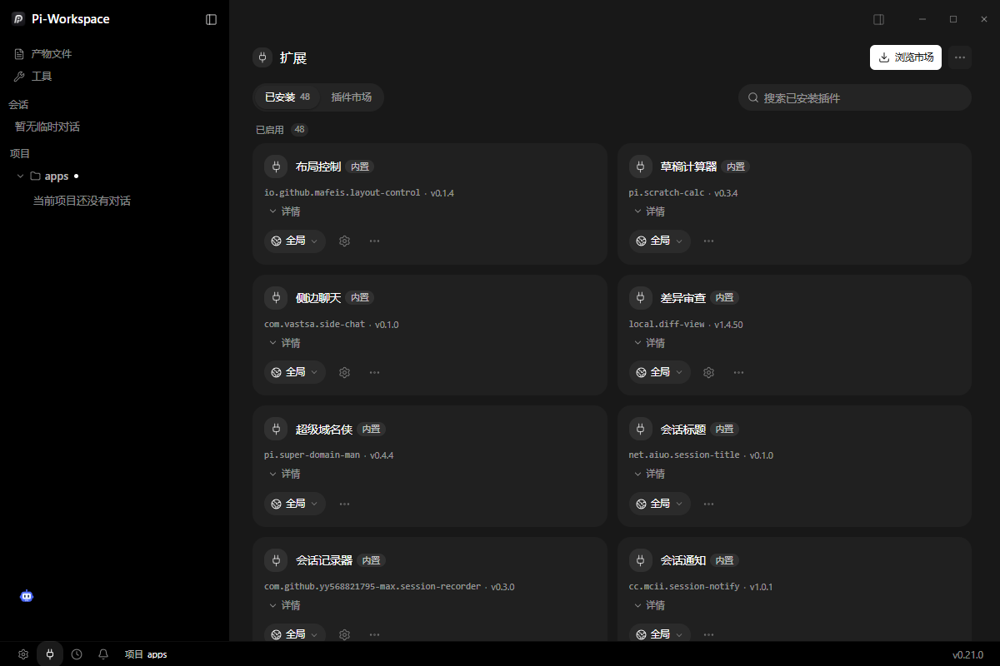

- 顶部：`已安装 46` / `插件市场`；「已启用 46」表示内置插件默认全开。
- 每张卡片：名称 + `内置` 徽章 + 插件 id + 版本 + `详情` + 作用域 + 齿轮（设置）+ `⋯`（更多）。
- 搜索框按名称过滤已安装插件。

插件能提供的东西（不止 Agent 工具）：`Command`、`Panel`、`Floating Widget`、`Work Panel View`、
`Agent Tool`、`Completion`、`Skill`、`Theme`、`MCP Server`、`Service`（常驻后台服务）、`Message Bus`（插件间通信）。

> **隐藏用法**：`Alt+Space` 打开**插件启动器**，一处直达所有插件命令与面板，不必先翻扩展页。

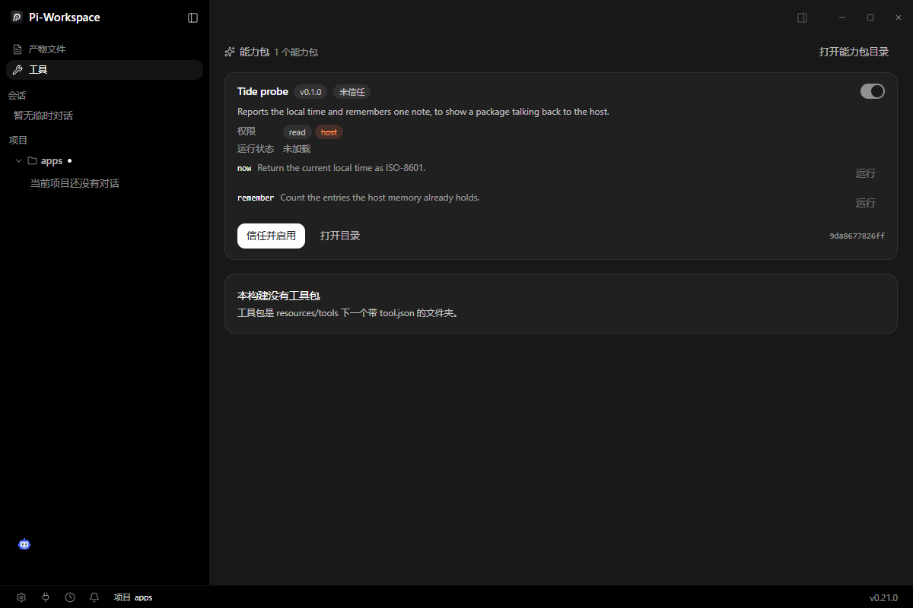

### 9.2 挂件（Tools 页上方）

来源：`<数据根>/data/widgets/<文件夹>/`，你自己放进去。由 Agent sidecar 进程执行，**执行代码**。

最小结构：

```text
<数据根>/data/widgets/<文件夹>/
  widget.json
  index.mjs        # 解析顺序 js → mjs → cjs
```

`widget.json`：

```json
{
  "schemaVersion": 1,
  "apiVersion": 1,
  "id": "example.tide-probe",
  "name": "Tide probe",
  "version": "0.1.0",
  "description": "一句话说明。",
  "permissions": ["read", "host"],
  "actions": [
    { "name": "now", "description": "返回当前时间。", "params": [] },
    { "name": "remember", "description": "统计记忆条数。", "params": ["note"] }
  ]
}
```

规则（都是踩过的坑）：

- `params` 必须是**字符串数组**；写成对象会报 `invalid type: map, expected a sequence`，卡片变红。
- `actions` 是唯一可调用面；模块里注册了但清单没声明的 action 调不到。
- 入口模块必须 **default export 一个 activate 函数**；`module.exports = {...}` 不会加载。
- 未受信任时只保留 `read` / `write` 权限；改任何一个字节都会改变摘要 → 信任自动撤销并标 `modified`。
- 上限：64 个挂件，每个 512 个文件 / 8 MB。
- 回连宿主只有 5 个方法：`memory.recall`、`memory.list`、`memory.stats`、`workspace.get`、`app.health`（需 `host` 权限）。

### 9.3 工具包（Tools 页下方）

来源：`<安装目录>/resources/tools`，随应用内置，**声明式元数据、不执行代码**：

```json
{
  "schemaVersion": 1,
  "id": "local.example.package",
  "name": "Example tools",
  "version": "0.1.0",
  "description": "What this package is for, in one line.",
  "tools": [{ "name": "inspect_widget", "description": "一行说明。", "risk": "low" }]
}
```

`schemaVersion` 必须是 `1`，否则该行显示"损坏"而不是被忽略。启用状态存 `<数据根>/data/tools/state.json` 的 `disabled` 数组。

### 9.4 插件退役与开发

- 随包插件由脚本从市场同步；**退役**走 `scripts/bundled-plugins-excluded.json`（同步脚本会把已展开副本一起删掉），
  本项目已按这条路径退役了 `community.workbuddy-connect`（原因见 8.3）。
- 写插件用内置技能 `plugin-development`：`/plugin-development` 或直接问 Agent。

---

## 10. 定时任务、通知与电源

### 10.1 定时任务

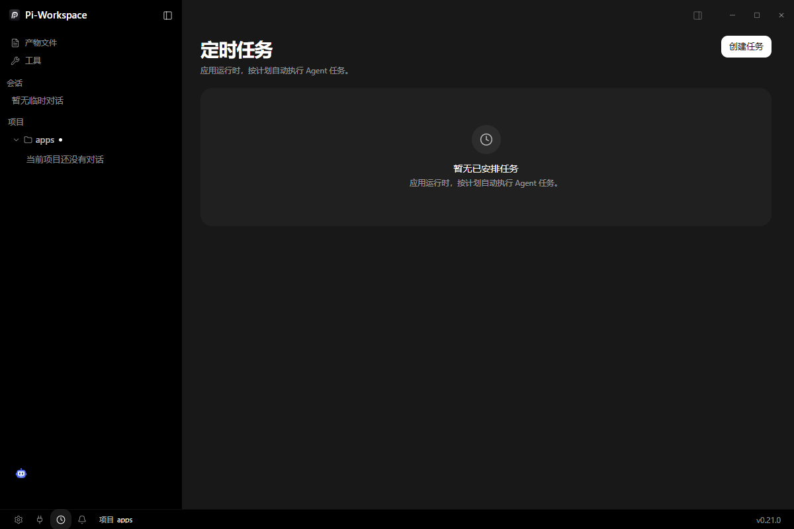

- 「应用运行时，按计划自动执行 Agent 任务。」右上角 `创建任务`。
- **只在应用运行时触发**；退出应用时未开始的计划不会补跑，进行中的会被取消。
- 是否允许定时任务在 **设置 → 行为 → 执行 → 定时任务**。

### 10.2 通知

- 任务结束、需要你回答、以及交互式提醒会走系统通知；点击会恢复并聚焦窗口。
- 系统通知被系统静音时，应用内的收件箱仍然完整。
- Windows 通知归属依赖应用身份：安装版用 NSIS 的快捷方式身份，免安装版可能显示为通用来源。

### 10.3 电源

**设置 → 系统 → 电源**：`保持电脑唤醒`（任务运行期间阻止休眠）、`阻止屏幕休眠`（阻止显示器睡眠）。
两者都只在有任务运行时生效。

---

## 11. 设置逐页说明（14 个目的地）

打开方式：左下齿轮，或 `Ctrl+,`。左栏分四组：**偏好 / 智能体 / 工作区 / 系统**；
顶部有「搜索设置…」（`Ctrl+K` 也能搜到设置项），底部固定「返回应用」。

> 这一版把设置拆成了"**一个目的地只管一个主题**"：原来的「常规」被拆成外观与系统，
> 原来的「AI」被拆成对话与行为。搜索结果会直接把你要的开关所在的目的地打开。

### 11.1 外观（偏好）

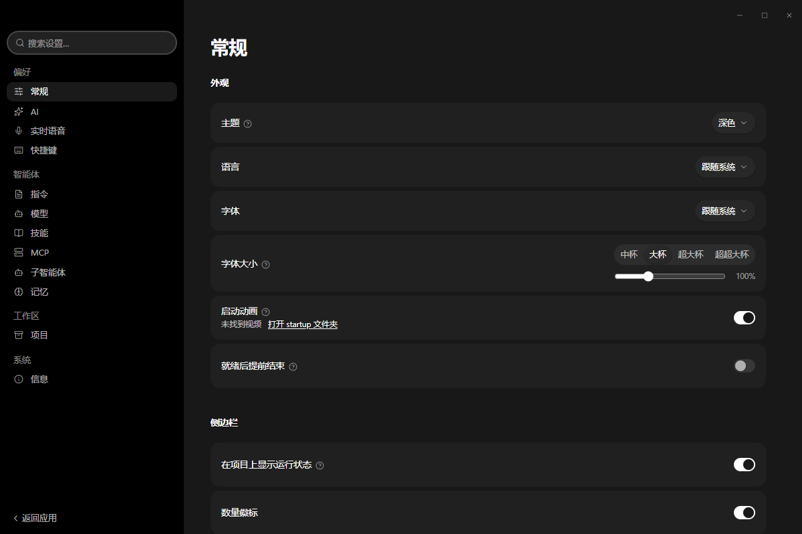

| 分区 | 选项 |
| --- | --- |
| 外观 | 主题（深/浅/跟随系统）、语言（跟随系统；内置 9 种：简体中文、繁體中文、English、Deutsch、Español、Français、한국어、Português (BR)、Türkçe）、字体、字体大小（四档预设 + 滑杆）、窗口通透度 |
| 侧栏 | 运行状态指示、数量徽标、活动流光、会话时间、定时任务、环形右键菜单（含四个方向的动作）|
| 启动 | 启动动画开关、就绪后提前结束 |

### 11.2 对话（偏好）

| 分区 | 选项 |
| --- | --- |
| 显示 | 显示思考、已完成思考自动收起、过程显示（三档）、已完成小组自动收起、上下文用量读数（已用/剩余）、平滑流式显示、聊天内嵌可视化 |
| 输入 | 回车发送、大段文本粘贴阈值、链接打开位置（工作区浏览器 / 系统浏览器）|

### 11.3 快捷键（偏好）

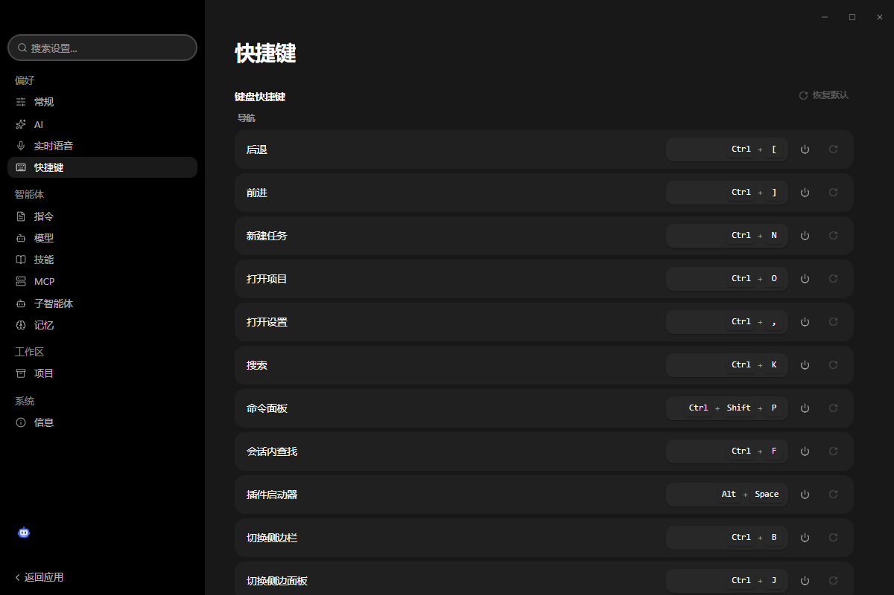

17 个可自定义动作，见第 12 节全表。每行可清空或录制新键；右上角「恢复默认」。

### 11.4 行为（智能体）

| 分区 | 选项 |
| --- | --- |
| 会话默认 | 默认模式（Agent / Plan / Goal，或你的自定义模式）|
| 执行 | 权限模式（**每次询问 / 自动接受编辑 / 全自动**）、命令 Shell、无尽重试、定时任务 |
| 说明 | 全自动会在不询问的情况下运行命令并可能改文件；单会话里仍可临时调整 |

### 11.5 模型（智能体）

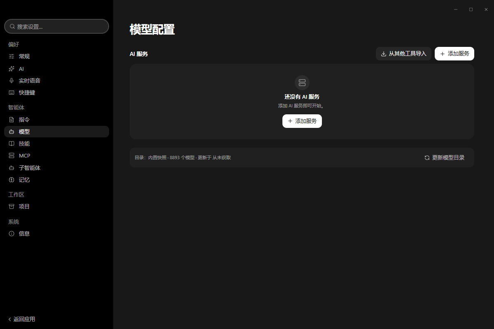

见第 8 节。含：服务列表、添加服务、从其他工具导入、厂商账号（OAuth）、图片模型、模型目录状态与更新按钮。

**每个服务的模型配置列表上方有一行批量上限**：`上下文窗口` / `最大输出` 两个下拉（默认"保持不变"）+ `应用`。
选好后一次写入该服务的全部模型，并标记为**你自己的值**——之后刷新模型目录不会把它改回去。

> **上下文窗口是怎么定的（三层）**：① 服务自己的 `/models` 上报的 `context_window` / `context_length` /
> `inputTokenLimit`；② models.dev 目录按模型 id 匹配（跨厂商、认 `-128k`/`-1m` 这类部署后缀）；
> ③ 都没有 → 兜底 **128k**（host 侧唯一常量）。第三层的行在窗口旁边有 ⓘ 提示
> 「服务和模型目录都没有公布这个值，当前按 128k 运行」——它表示这是兜底值，不是模型的真实容量。
> 典型分界线：**服务端会上报的网关**（如内置 WorkBuddy）逐个拿到 1M / 960k / 192k；
> **纯数字 id 且不上报的平台**（如 changan 的 `10292`）只能落 128k，用上面那行批量设置一次即可。

### 11.6 指令（智能体）

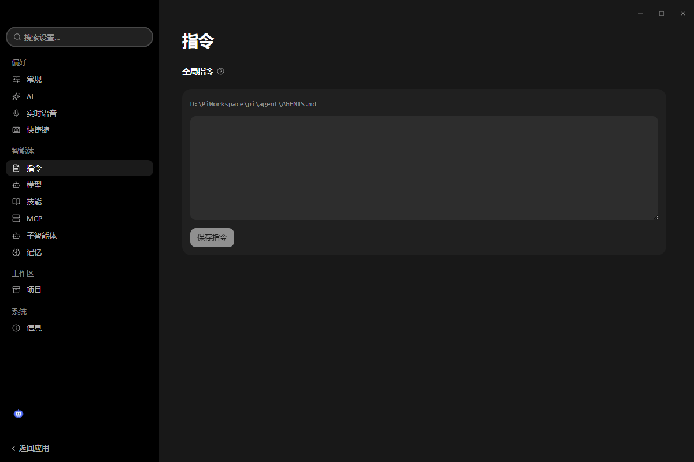

- 上方显示全局指令文件路径（`<数据根>/pi/agent/AGENTS.md`）。
- 文本框里写长期指令（编码规范、语言偏好、禁改文件），点 `保存指令` 落盘。
- 项目级指令放项目根的 `AGENTS.md`。

### 11.7 技能（智能体）

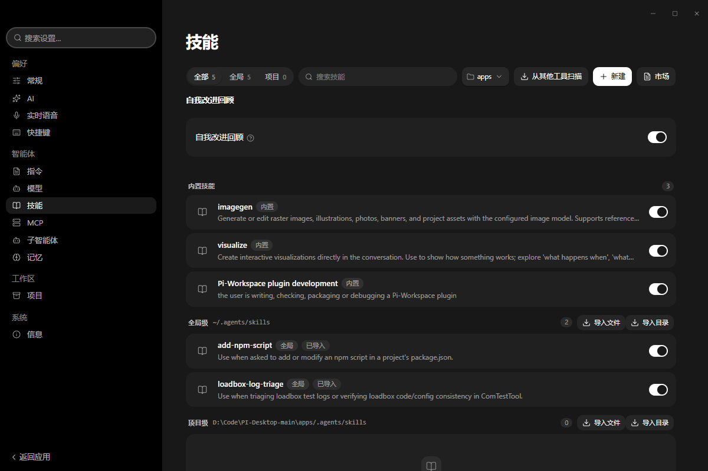

见 7.3。页面显示全局与项目两个路径，以及各自的导入/导出与"从其他工具扫描"。

### 11.8 MCP（智能体）

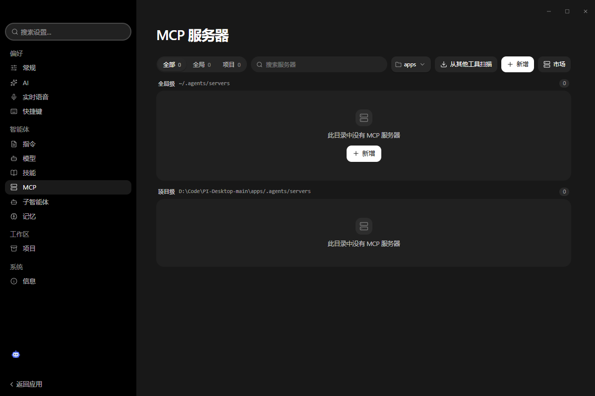

见 7.4。空态：`此目录中没有 MCP 服务器`。

### 11.9 子智能体（智能体）

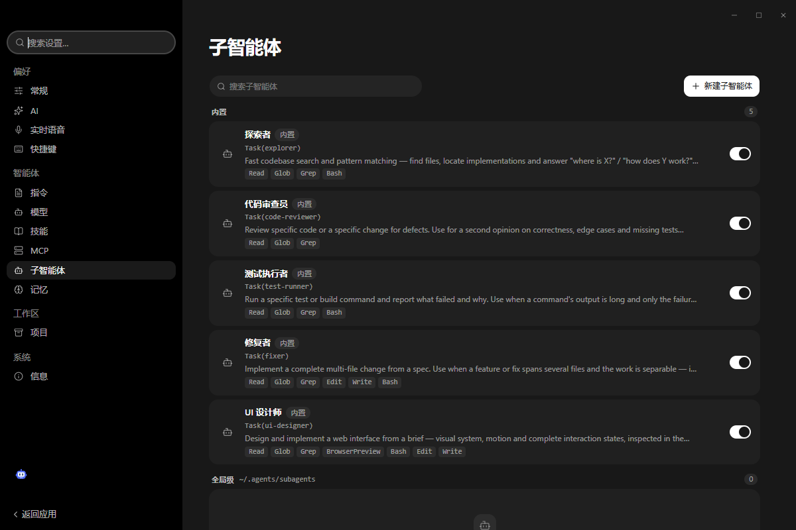

见 7.1。页面顶部提示：`子智能体仅支持全局级，暂不支持项目级定义。`

### 11.10 模式（智能体）

内置 3 个 + 你放在 `~/.pi/modes` 的模式。每个模式可查看/编辑定义、复制内置模式为新 id、
删除用户模式（内置不可删）。撞名或非法文档会在这里被明确报出来。

### 11.11 记忆（智能体）

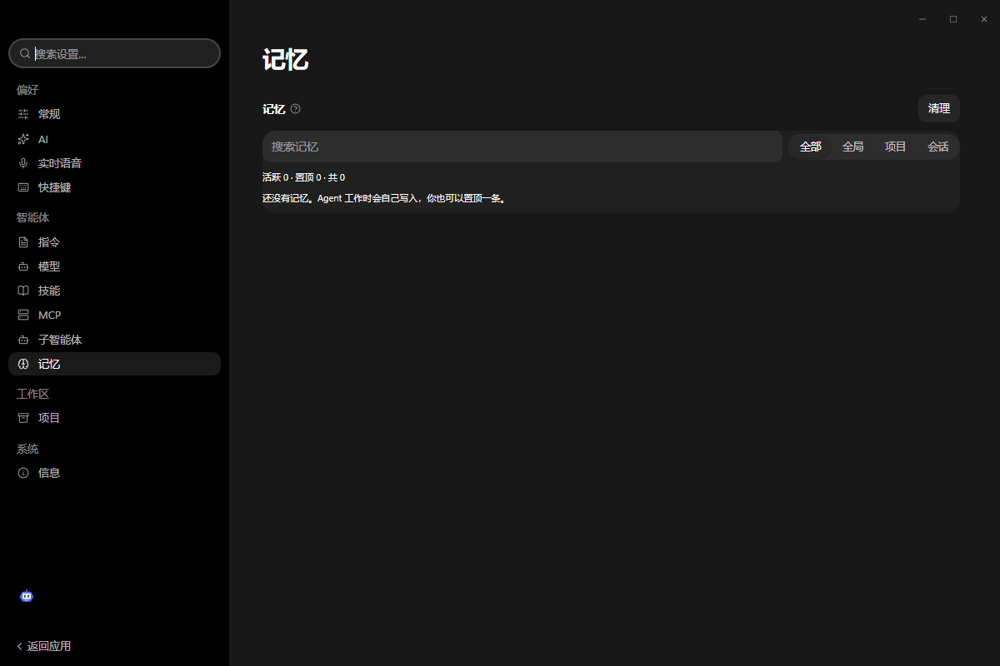

见 7.5。筛选 `全部 / 全局 / 项目 / 会话`，搜索框，右上角 `清理`。

### 11.12 项目（工作区）

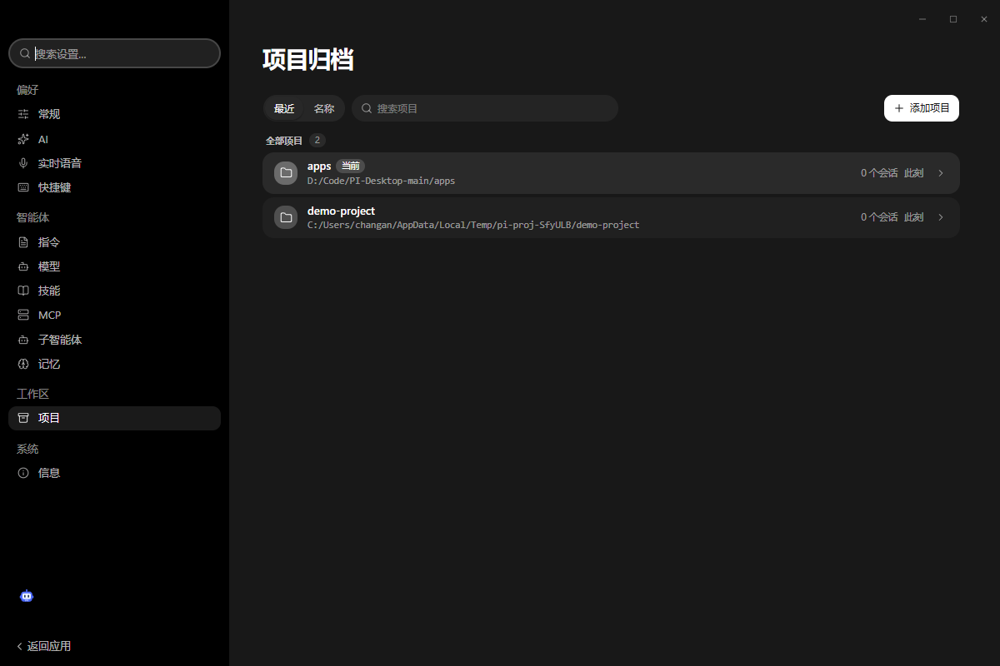

- 排序（最近/名称）、搜索、`+ 添加项目`；每行显示路径、会话数、最近活动时间。

### 11.13 系统（系统）

| 分区 | 选项 |
| --- | --- |
| 网络 | 代理（系统 / 直连 / 自定义 + URL）、网络宽松模式 |
| 存储 | 数据保存路径（可「更改路径…」）、可清理缓存体积 + 「清理缓存…」、备份 |
| 电源 | 保持电脑唤醒、阻止屏幕休眠 |
| 关闭行为 | 关闭到托盘 / 退出应用 |
| Python | 见下方「Python 解释器」|

**Python 解释器**（本版新增，**没有开关**——应用总要用某个解释器，只有"用哪个"这一个决定）：

| 元素 | 含义 |
| --- | --- |
| 当前使用 | 实际会跑的 `python.exe` 路径 + 版本 + 来源徽标（内置运行时 / PATH / 数据目录 venv / 常见安装目录 / 设置里指定）|
| 自动选择 | 默认。优先用你自己的环境，找不到合适的才回退内置运行时 |
| 扫描列表 | 每行一个解释器：路径、版本、来源、**是否能 import 文档库**（openpyxl / docx / pptx / pandas / PIL / pypdf）|
| 浏览… | 扫描不到时手动指定一个 `python.exe`；选定即生效（下次启动用它）|
| 重新扫描 | 装完新 Python 或 venv 后刷新列表 |

自动模式的顺序（源码 `python-runtime.ts`，唯一实现）：

```
1. PI_DESKTOP_PYTHON / PI_AUTOTEST_PYTHON 环境变量（CI / 高级用法）
2. 设置里指定的路径（本页）
3. <数据目录>/python/venv        ← 你自己建的 venv，升级不覆盖
4. PATH 上的 CPython ≥3.10，且必须能 import 那 6 个文档库
5. <resources>/python/runtime    ← 内置兜底
```

要点：

- **裸 python 不会夺权**：PATH 上的 3.14 如果没装 openpyxl/pandas，会被跳过，继续用内置栈（否则表格一读就崩，比不换更糟）。
- **库版本按解释器给**：内置的 `site-packages` 是 CPython 3.12 的二进制轮子，只挂给 3.12 的解释器；换成 3.13 就不挂（挂上必崩）。
- 用你自己的解释器时**不再设置** `PYTHONHOME`（会把它弄坏），也**不再设** `PYTHONNOUSERSITE`（否则正好把它的库藏起来）。
- 想固定用某一端：`PI_PYTHON_STRATEGY=bundled`（只用内置）或 `=system`（只用系统的，没有就报错）。
- 用户库目录仍是 `<数据目录>/python-site`（优先于内置库），把 `.whl` 丢进 `python-site-drop` 会自动安装。

> 网络宽松模式的作用是把"你自己填写的地址"（本机或局域网的模型服务、MCP、市场源、git 远端）放行：
> 允许明文 HTTP，也容忍代理的 fake-IP 应答。内网自签证书场景开它，而不是全局关掉代理。

### 11.14 信息（系统）

| 项 | 内容 |
| --- | --- |
| 应用 | 产品名与版本 |
| 日志 | `打开日志` → 直接打开日志目录（排障首选）|
| 使用说明 | `手动更新`：打开这份手册；文案是「当前版本的使用说明，随应用一起更新。」解析顺序见下方 |
| 开发者 | 开发者模式开关（打开后出现开发者工具等入口）|

> 对外分发的构建不暴露上游身份：信息页只显示产品名、版本、日志与手册，不指向其他项目。
>
> **手册优先顺序（隐藏细节）**：`<数据根>\components\manual\` 里的 `Pi-Workspace-*.md` **优先于**随包副本。
> 也就是说你可以把自己的版本（或公司内部增补版）放进这个目录，点「使用说明」打开的就是你的那份，
> 而且它**不会被下一次升级覆盖**。同一个机制还作用于 `components\gen-ui`（可视化样式）与 `components\models.dev`（模型目录快照）。
> 想让随包版本重新生效，把 `components\manual` 删掉即可。

---

## 12. 快捷键、命令面板与斜杠命令

### 12.1 全部 17 个可自定义快捷键

| 分组 | 动作 | 默认键（Windows）|
| --- | --- | --- |
| 导航 | 后退 | `Ctrl+[` |
| 导航 | 前进 | `Ctrl+]` |
| 导航 | 新建任务 | `Ctrl+N` |
| 导航 | 打开项目 | `Ctrl+O` |
| 导航 | 打开设置 | `Ctrl+,` |
| 导航 | 全局搜索 | `Ctrl+K` |
| 导航 | 命令面板 | `Ctrl+Shift+P` |
| 导航 | 会话内查找 | `Ctrl+F` |
| 导航 | 插件启动器 | `Alt+Space` |
| 导航 | 切换侧边栏 | `Ctrl+B` |
| 导航 | 打开工作面板 | `Ctrl+J` |
| 智能体 | 中止当前回合 | `Ctrl+.` |
| 窗口 | 显示/隐藏窗口 | `Alt+Shift+W` |
| 窗口 | 重置缩放 | `Ctrl+0` |
| 窗口 | 放大 | `Ctrl+=` |
| 窗口 | 缩小 | `Ctrl+-` |
| 窗口 | 全屏 | `F11` |

> 旧版本有 `closeWindow`（`Ctrl+W`）/ `summonWindow`（`Ctrl+Shift+W`）两个动作，现已合并为「显示/隐藏窗口」。
> 你自定义过的绑定会被折叠进这个新动作；如果你没改过，`Ctrl+W` 归还给系统（关窗由窗口自己的按钮负责），
> 这正是这一版故意不再劫持 `Ctrl+W` 的原因。

### 12.2 命令面板（`Ctrl+Shift+P`）与全局搜索（`Ctrl+K`）是同一个框

两者是**同一个搜索框的两种模式**，不是两个界面：

| 模式 | 快捷键 | 搜什么 | 占位文案 / 空态 |
| --- | --- | --- | --- |
| 全局搜索 | `Ctrl+K` | 会话与消息内容、页面、设置项、命令 | 空态「没有匹配的命令」（命令区），结果可「加载更多」分页 |
| 命令模式 | `Ctrl+Shift+P` | 只搜命令：新建任务、压缩上下文、三个模式切换、Fast、插件命令、技能、MCP 工具 | 占位「输入命令…」，空态「没有匹配的命令」 |

命令列表初始化失败时，对话框里会显示「初始化命令失败。」并提供「重试启动」——不用重启整个应用。

### 12.3 斜杠命令

见 3.3（`/new`、`/compact`、`/agent-mode`、`/plan-mode`、`/goal-mode`、`/fast` + 插件/技能/MCP 动态命令）。

---

## 13. 数据、备份与迁移

### 13.1 数据根

安装版与免安装版默认在**非系统盘**上独占一个目录：`D:\PiWorkspace`（没有 D 盘按 E、F… 顺延；
都没有才回落到用户目录）。目录名就是存储标识，所以两个安装不会共用一个根。

```text
D:\PiWorkspace\
  components\          用户覆盖组件（优先于随包副本）
    manual\            你放进去的手册 → 「使用说明」打开的就是它
    gen-ui\            覆盖可视化样式（visualize.css）
    models.dev\        覆盖模型目录快照（api.json）
  data\                应用数据主体
    pi.sqlite          会话、消息、项目、提供商、记忆、模式运行记录…
    pi.sqlite-wal/-shm   WAL 与共享内存（三个文件要一起复制备份）
    pi.sqlite.vNN.bak   升级前按 schema 版本留的备份
    pi.sqlite.bak-<时间戳>  手动/自动的带时间备份
    tmp\               运行时临时文件（下载、handoff、解包、脚本）全部落这里
    logs\app\           应用日志（lifecycle / provider / plugin / runtime）
    logs\agent\         Agent 运行时日志
    logs\host\          本地 host 服务日志
    sessions\           会话附件与派生数据
    attachments\        输入区附件
    cache\              可清理缓存
    plugins\            installed / disabled / backups / cache / data
    widgets\            你放的挂件（state.json 记录启用集）
    tools\state.json    工具包启用状态
    capabilities\ · agent-capabilities\   能力快照与可用工具面
    autotest\           内置 AutoTest 服务的运行数据
    python-site\        随包 Python 的 site-packages（第三方依赖落这里）
    secrets\            受限密钥材料（不写数据库明文）
    review-changes\     审查面板的改动快照
    crash-dumps\ · exit-reasons.log · run-marker.json   崩溃与退出诊断
    sidebar-preferences.json · window-state.json         窗口与侧栏记忆
  agents\skills\       全局技能目录（= 用户目录下的 ~/.agents/skills）
  pi\agent\            全局 Agent 状态（auth.json、extensions）
  userdata\            Chromium 用户数据（缓存、Local Storage 等）
  legacy\ · docs\       旧版本迁移遗留（docs 下那份旧使用说明不再被打开）
  ms-playwright\ · pi-diff-view\ · pi-workbuddy-connect\   运行时依赖解包目录
```

> 所有运行时临时文件都在 `<数据根>/data/tmp` 下，不会散落到系统临时目录——这也是这一版的硬约束。

### 13.2 改路径 / 清理 / 备份

- **更改路径**（设置 → 系统 → 存储）：应用会把现有数据整体搬过去，重启后生效。
- **清理缓存**：按钮旁显示可回收体积。
- **备份**：直接复制整个数据根即可；`pi.sqlite*` 三个文件要一起复制（WAL 模式）。

### 13.3 会话迁移

可从 Claude Code / Codex / OpenCode / Pi 导入本地会话（设置 → 模型 → 从其他工具导入 / 相应面板）。

---

## 14. 故障排查

排障第一入口：**设置 → 信息 → 打开日志**（`<数据根>/data/logs`）。

### 14.1 发消息时选不到模型

没配置任何可用服务。→ 设置 → 模型 → `+ 添加服务`。若服务在但为空，检查 Base URL 是否漏了 `/v1`。

### 14.2 内置提供商卡片显示「网关未运行」

看卡片上的原因：

| 原因 | 处理 |
| --- | --- |
| `port ... in use`（端口被占）| 应用会自动顺延到下一个空闲端口；若仍失败，关掉占用该端口的程序后重启应用 |
| 网关文件缺失 | 重装或重新解压（`resources/in-app-providers/workbuddy/gateway.cjs` 必须在）|
| 本机没有 WorkBuddy 客户端登录 | 先登录 WorkBuddy 客户端，再重启 Pi-Workspace |

### 14.3 任务栏图标不对，或名字显示 Electron

**根因**：Windows 按"认领了同一个 AppUserModelID 的开始菜单快捷方式"画任务栏按钮。
免安装版不认领该 ID，于是任何残留的 `Electron` 快捷方式（开发模式跑 `electron.exe` 留下的）都会劫持它。

处理：

1. 打开 `%APPDATA%\Microsoft\Windows\Start Menu\Programs\`，如果有一个 `Electron.lnk`（目标指向
   `node_modules\...\electron.exe`），把它删掉或移走；
2. 结束并重新启动 Pi-Workspace；
3. 如果仍不对，说明还有另一个快捷方式指向同一个 ID：在开始菜单搜 `Pi-Workspace`，只保留安装版那条。

> 安装版不受影响：它自带 `Pi-Workspace` 快捷方式并认领 ID。

### 14.4 打包/覆盖安装时报 `EBUSY` 或 `EPERM`

有进程正从目标目录运行（`win-unpacked` 里跑着应用），或某个运行时 DLL 被占用。
**先关闭应用**（以及占用该目录的进程）再操作；不要用"另建一个目录"的方式绕过，否则会出现多份产物。

### 14.5 提示 `PYTHON_RUNTIME_UNAVAILABLE`

随包的 Python 运行时缺失或被占用：Office/文档类工具会报这个码，其余功能不受影响。
重新安装/重新解压即可恢复。

### 14.6 挂件卡片变红

- `invalid type: map, expected a sequence` → `params` 写成了对象，改成字符串数组（见 9.2）。
- 显示 `未信任` + `未加载` → 首次出现或被改过，点 `信任并启用`。
- `duplicate id` → 两个文件夹用了同一个 `id`。

### 14.7 升级后数据看起来"回到了旧版本"

每次 schema 升级前都会留 `pi.sqlite.vNN.bak`。确认新库是否正常打开后再删除备份；
若启动异常，关闭应用，把 `pi.sqlite` 换成对应的 `.bak` 再启动。

### 14.8 想彻底重置

关闭应用 → 删除或重命名数据根（`D:\PiWorkspace`）→ 重启。**这会清空会话与设置**，先备份。

---

## 15. 隐藏用法集锦（33 条）

1. **`Ctrl+Shift+P` 是能力目录**：内置命令、插件命令、技能、MCP 工具全在一个列表里。
2. **`/` 是搜索**：打 `/` 再打两个字母，能在插件/技能/MCP 之间按名字筛。
3. **`Alt+Space` 插件启动器**：不进扩展页就能开插件面板与命令。
4. **`Ctrl+J` 回到上次的工作面板布局**：Diff / 文件 / 浏览器可以并排钉在一起。
5. **`Ctrl+.` 中止**：等本地命令落定才把控制权交回模型，不会留下半截操作。
6. **运行中继续输入不会被吞**：消息进队列，在合适间隙插入。
7. **`@子智能体` 只在 Agent 模式生效**；Plan/Goal 里手打 `@` 就是普通文字。
8. **`@` 只在词边界解析**，所以 `user@host`、邮箱不会被误伤。
9. **大段粘贴会自动折叠**成附件（阈值可调）。
10. **文件引用点一下是"打开所在文件夹"**，不是打开编辑器。
11. **`Ctrl+F` 只搜当前会话**；跨会话搜索是 `Ctrl+K`。
12. **计划审批卡可改**：Plan 模式产出的计划你可以直接编辑条文再批。
13. **`/compact` 比"新开会话"更好用**：它保留结论与约束，丢掉冗余过程。
14. **自定义模式就是三个文件**：`mode.md` + `templates/` + 你写的提示词；不用重启就生效。
15. **内置模式 id 保留**：想改 Plan 的行为，复制成新 id，而不是覆盖内置。
16. **分阶段模式的闸门能跑命令**：`exit: [{ run: pnpm test, onFail: { retries: 3 } }]`。
17. **`contract` 阶段不用给 Write 权限**：模型用 `CompleteStage` 交产物，Host 负责写盘。
18. **技能可以带脚本与模板**：不是只有提示词，`scripts/`、`templates/`、`assets/` 都能随技能走。
19. **技能可置顶免疫清理**：库按空闲天数维护，置顶的不动。
20. **两个技能能合并**：把 B 吸收进 A，内容不丢（适合长期积累后收敛）。
21. **MCP 工具能直接点名调用**：`/mcp:<服务器id>:<工具名>`。
22. **后台任务三件套**：`TaskList` / `TaskWait` / `TaskStop`，长命令不占对话。
23. **子智能体可指定模型与思考档位**：贵的活给强模型，机械活给快模型。
24. **内置提供商开关会持久化**：关掉 WorkBuddy 后，下次启动它仍然是关的。
25. **数据根可以在非系统盘**：换盘走 设置 → 系统 → 存储 → 更改路径，应用会整体搬迁。
26. **`visualize` 技能"不见了"不是 BUG**：它由「聊天内嵌可视化」开关决定，默认关闭（见 3.6）。
27. **`Ctrl+K` 与 `Ctrl+Shift+P` 是同一个搜索框**：前者全文、后者只看命令，别去找第二个界面。
28. **命令列表加载失败可以就地重试**：对话框里的「重试启动」比重启整个应用快。
29. **`Ctrl+W` 已归还给系统**：这一版不再把关闭窗口绑成可配置快捷键，避免和系统关窗打架。
30. **卡片写 `Ctrl+.` 的双重身份**：空闲时是发送键位的邻居，运行中才是"中止"——中止会等本地操作落定。
31. **手册可以被你换掉**：`<数据根>\components\manual\` 优先于随包手册，升级不会被覆盖（见 11.14）。
32. **`components` 还能覆盖另外两样东西**：`gen-ui`（可视化样式）与 `models.dev`（模型目录快照）。
33. **`data\tmp` 可以放心清空**：里面只有运行时临时文件，清掉不影响会话与设置。

---

## 附：本版与上一份手册的差异

| 位置 | 变化 |
| --- | --- |
| 设置 | 由「常规 + AI」拆成 **14 个目的地**（外观 / 对话 / 快捷键 / 行为 / 模型 / 指令 / 技能 / MCP / 子智能体 / 模式 / 记忆 / 项目 / 系统 / 信息）|
| 模式 | 从"三个固定模式"变成 **三个内置 + 用户自定义分阶段工作流**（frontmatter、产物、闸门、预算）|
| 模型 | 新增 **内置提供商 WorkBuddy**（无需密钥、自动登记、带状态卡片与开关）|
| 插件 | 48 → **46**：`community.workbuddy-connect` 退役（网关已并入应用）|
| 输入区 | 新增 `@子智能体` 委派、双栏模型选择器、推理档位、`/fast` |
| 权限模式 | 两档 → **三档**（每次询问 / 自动接受编辑 / 全自动）|
| 快捷键 | 补全为 **17 个**（新增中止、缩放、全屏、窗口显示隐藏）|
| 数据 | 运行时临时文件统一落 `<数据根>/data/tmp`；升级前留 `pi.sqlite.vNN.bak` |
| 排障 | 新增任务栏身份、端口冲突、`EBUSY`/`EPERM`、Python 运行时缺失等条目 |
| 可视化 | 「聊天内嵌可视化」默认关闭，并**同时决定** `visualize` 技能是否出现 |
| 搜索 | `Ctrl+K` 与 `Ctrl+Shift+P` 统一为同一个搜索框的两种模式 |
