# Pi-Workspace 构建与使用手册（v0.21.0 / Windows）

> 本手册由一次真实的发布构建过程整理：从拉取 `main` 分支，到产出可安装包，再到逐页操作说明。
> 全部截图均为本次构建产物（Pi-Workspace 0.21.0）的真实界面。

## Pi-Workspace 是什么

**Pi-Workspace 是一款面向 AI Agent 的模块化桌面工作台**：Electron + React 渲染层，
Rust `host-core` 负责持久化与原生能力，Node `agent-runtime` 负责 Agent 执行。
它不绑定某个 IDE、某个终端，也不绑定某一家模型厂商，而是给 Agent 一个**长期存在、可扩展的独立工作空间**——
项目、会话、插件、模型、工作面板、定时任务都在同一个桌面应用里持续存在。

一句话定位：**不是「某个模型的套壳」，也不是「某个 IDE 的插件」，而是 Agent 工作流的桌面平台。**

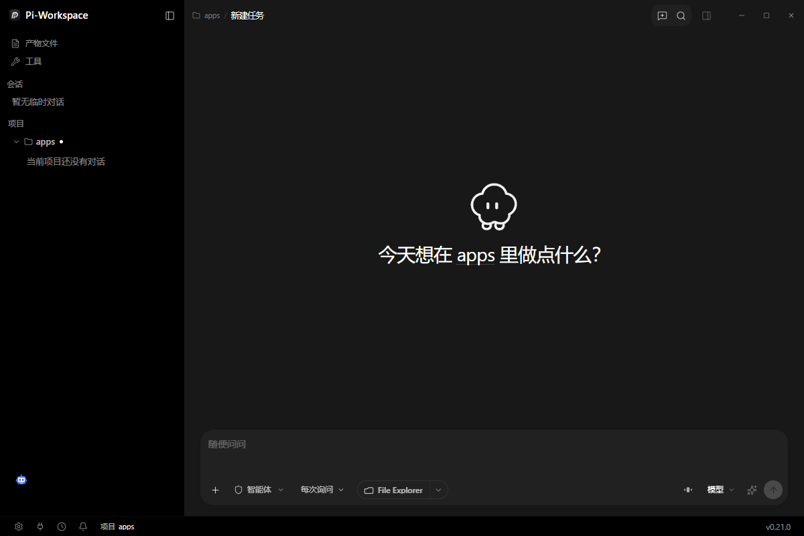

---

## 核心特性总览

### 1. 独立的持久化工作区（Project → Session → Agent → Work）

围绕「项目 → 会话 → Agent → 工作」组织，而不是一次性聊天窗口。

- 多项目、多会话并行管理，可固定、归档、分支、搜索会话
- **会话可跨多次启动继续**；流式检查点保留进度，中断后尽可能恢复
- 支持 `@` 引用项目文件、斜杠命令、Agent 运行中排队新指令
- 内置 Diff 审查、命令输出查看、右侧工作面板（Work Panel）

### 2. 三种工作模式：Agent / Plan / Goal

| 模式 | 含义 | 适用场景 |
| --- | --- | --- |
| **Agent** | 给任务直接干活：读代码、改文件、跑命令、测试、迭代 | 日常开发 |
| **Plan** | 先研究项目、产出实施计划，你审完再执行 | 重构、高风险改动 |
| **Goal** | 锁定目标与验收标准，让 Agent 自己选路径推进 | 复杂、长周期任务 |

特权操作一律经过权限层，由你决定每个会话的自主程度。

### 3. 多级 Agent 编排（Subagents + Session Orchestrator）

- **子智能体（Subagents）**：把独立工作委派给后台 Agent（代码探查、实现、测试分析、评审），
  各自独立上下文，结果回传父 Agent。本构建内置 5 个：探索者、代码审查员、测试执行者、修复者、UI 设计师。
- **会话编排（Worker Sessions）**：长周期工作拆给多个**完整会话**并行推进（前端 / 后端 / 测试 / 评审），
  每个 Worker 都是可检视、可复用、带完整 transcript 的真实会话。

### 4. 模型自由（Model-Agnostic）

- 支持 OpenAI、Anthropic、OpenAI 兼容 API、自定义网关、Ollama、LM Studio、本地模型
- 每个模型独立配置：Provider、Model ID、上下文窗口、输出上限、推理档位、温度、OAuth / API Key、Endpoint
- **同一会话随时切换模型**：规划用 A、编码用 B、评审用 C、隐私任务走本地模型
- 内置 models.dev 目录快照（本构建 8893 个模型），可一键刷新

### 5. 插件即工作区的一部分（Plugin-Powered）

插件不止扩展 Agent，也扩展桌面本身。可提供：

`Command`（全局命令）、`Panel`（独立界面）、`Floating Widget`（悬浮挂件）、
`Work Panel View`（右侧新视图）、`Agent Tool`（Agent 可调用工具）、`Completion`（复用已配模型）、
`Skill`（技能）、`Theme`（主题）、`MCP Server`（本地 / 远程 MCP）、`Service`（常驻后台服务）、
`Message Bus`（插件间通信）。

可分发布为 `.piplug` 包，也可从插件市场安装（本构建内置 48 个插件，默认全部启用）。

### 6. 技能 / MCP / 记忆 / 子智能体 四件套

- **技能**：内置 + 全局 `~/.agents/skills` + 项目级 `<项目>/.agents/skills`，可导入导出、从其他工具扫描
- **MCP**：全局 `~/.agents/servers` 与项目级 `<项目>/.agents/servers`，支持扫描、新增、市场
- **记忆**：Agent 工作中自动写入，可按 全局 / 项目 / 会话 筛选、置顶、清理
- **子智能体**：可自定义提示词与工具白名单

### 7. 定时任务、生成式 UI 与产物清单

- **定时任务**：应用运行时按计划自动执行 Agent 任务
- **生成式 UI**：Agent 可在会话中直接渲染交互式卡片与可视化组件
- **产物文件**：会话写入或修改过的文件自动汇总成可点击清单

### 8. 本地优先 + 权限可控

| 数据 | 默认行为 |
| --- | --- |
| 项目 / 会话 / 设置 / 日志 | 全部本地 |
| API 凭证 | 操作系统钥匙串 |
| 遥测 | 无 |
| 模型请求 | 直连你配置的服务商 |

- **无强制账号、无强制中转**；使用远程模型时，请求所需上下文直接发往该服务商
- 权限层：`Agent → 工具请求 → 权限层 → 允许 / 询问 / 拒绝 → 执行`，可设为「每次询问」
- 渲染层沙箱运行，SQLite 由 Rust `host-core` 独占，插件权限边界不越权

### 9. 迁移友好 + 三平台发布

- 可从 `Claude Code`、`Codex`、`OpenCode`、`Pi` 导入本地会话，不用推倒重来
- macOS（Apple Silicon / Intel，已签名并公证）、Windows x64（安装包 / ZIP）、
  Linux x64 & ARM64（AppImage / deb / rpm / asar，需 glibc 2.35+）

> 核心只提供地基，**插件决定你的工作区长成什么样**：AI 开发工作台、语音助手、DevOps 控制台、
> GitHub 工作区、数据分析助手、多 Agent 控制中心、自动化平台……都由扩展组合而成。

---

## 本构建（0.21.0）速览

| 项目 | 值 |
| --- | --- |
| 产品名 | Pi-Workspace |
| 版本 | 0.21.0 |
| 提交 | `b40b056` feat(capabilities): run user capability packages in the agent sidecar |
| 平台 | Windows x64 |
| 协议 / 宿主 | protocol 11 · host 0.21.0 |
| 内置插件 | 48 个（默认全部启用） |
| 内置子智能体 | 5 个 |
| 模型目录 | 内置快照 8893 个模型 |
| 安装包 | `Pi-Workspace-Setup-0.21.0.exe`（187,368,021 字节，MD5 `611d67dee873d8ba2214d1faecb4606b`） |
| 免安装包 | `Pi-Workspace-Portable-0.21.0.zip`（258,148,133 字节，MD5 `a7ca7181d0e3e304e6ef70373cf043ec`） |

---

## 目录

1. [环境准备](#1-环境准备)
2. [拉取最新 main](#2-拉取最新-main)
3. [安装依赖](#3-安装依赖)
4. [编译 Rust 宿主 host-core](#4-编译-rust-宿主-host-core)
5. [打包前处理：agent-runtime 与 Python 运行时](#5-打包前处理agent-runtime-与-python-运行时)
6. [构建渲染层与主进程](#6-构建渲染层与主进程)
7. [生成安装包（NSIS / ZIP）](#7-生成安装包nsis--zip)
8. [产物核对](#8-产物核对)（含 [8.1 手册随包发布](#81-手册随包发布)）
9. [安装与卸载](#9-安装与卸载)
10. [首次启动与界面总览](#10-首次启动与界面总览)
11. [数据目录与存储](#11-数据目录与存储)
12. [设置逐页说明](#12-设置逐页说明)
13. [其它页面：产物文件 / 工具 / 扩展 / 定时任务](#13-其它页面产物文件--工具--扩展--定时任务)
14. [故障排查](#14-故障排查)
15. [附录：文件清单与校验](#15-附录文件清单与校验)

---

## 1. 环境准备

| 组件 | 版本要求 | 本次实测 |
| --- | --- | --- |
| Node.js | ≥ 22.19 | v22.23.3 |
| pnpm | ≥ 10（仓库 `packageManager` 声明 12.8.1） | 12.8.1 |
| Rust / Cargo | stable（仓库使用 edition 2024 工具链） | rustc 1.98.1 |
| Python（仅打包时需要） | **3.12.x**（脚本硬校验，见第 5 节） | 3.12.13（由 `python-build-standalone` 提供） |
| 操作系统 | Windows 10/11 x64 | Windows 11 |

> 注意：`node_modules/.pnpm/electron@43.6.0` 的 `dist/` 目录在首次使用时才会下载 Electron 二进制。如果构建时提示找不到 `electron.exe`，先执行一次：
>
> ```powershell
> $env:ELECTRON_MIRROR = "https://npmmirror.com/mirrors/electron/"
> ./node_modules/.bin/electron --version
> ```

---

## 2. 拉取最新 main

```bash
git fetch origin main
git status --short
git log --oneline -1
```

本次构建的基线：

```text
b40b056 feat(capabilities): run user capability packages in the agent sidecar
```

`git status --short` 应当只剩与本任务无关的本地未跟踪文件。若有自己的改动，请先提交或另建分支。

> 仓库规范要求「1 个请求 = 1 个分支 + 1 个独立 worktree」。**发布构建属于只读操作，可以直接在主检出目录进行**；如果你要改代码再打包，请先 `git worktree add` 出新工作区。

---

## 3. 安装依赖

```bash
pnpm install --frozen-lockfile
```

- 依赖包含 JS 包（pnpm workspace）与 Rust crate（Cargo workspace），两者各自解析。
- 若网络受限，可设置 `ELECTRON_MIRROR`、`COREPACK_NPM_REGISTRY` 等镜像变量后重试。

---

## 4. 编译 Rust 宿主 host-core

Pi-Workspace 的持久化与原生能力由 Rust 宿主 `host-core` 提供，发布版必须用 **release 配置**编译：

```bash
cargo build --release --locked -p host-core
```

产物：

```text
target/release/pi-desktop-host-core.exe
```

本次实测耗时约 5 分 30 秒，产物大小约 21 MB。electron-builder 会把该文件复制为
`<安装目录>/resources/bin/pi-desktop-host-core.exe`。

> 也可以用 `pnpm --filter @pi-workspace/desktop run build:host-release`，它等价于上面的 cargo 命令。

---

## 5. 打包前处理：agent-runtime 与 Python 运行时

### 5.1 打包 agent-runtime

```bash
pnpm --filter @pi-workspace/agent-runtime bundle
```

该命令执行 `packages/agent-runtime/scripts/bundle.mjs`，把 Agent 运行时打成 `dist-bundle/`，
随后被复制为 `<安装目录>/resources/agent-runtime`。

### 5.2 Python 运行时（本步最容易卡住）

```bash
node scripts/bundle-python-runtime.mjs
```

脚本 `scripts/bundle-python-runtime.mjs:128` 的 `resolvePython()` **只接受 3.12.x**：

```text
Error: no Python 3.12 on PATH. Pass --python <exe>. The runtime shipped in the image is
built separately; this interpreter only installs the wheels.
```

三种处理方式，任选其一：

| 方式 | 命令 | 说明 |
| --- | --- | --- |
| 指定解释器 | `node scripts/bundle-python-runtime.mjs --python "C:\\Python312\\python.exe"` | 该解释器只用于装 wheel，不进入产物 |
| 复用已有 wheel | `node scripts/bundle-python-runtime.mjs --from ./wheelhouse` | 联网受限时最稳 |
| 沿用已有产物 | 跳过本步 | `apps/desktop/resources/python/` 已含完整运行时与 `MANIFEST.json` 时可直接打包 |

产物结构：

```text
apps/desktop/resources/python/
  MANIFEST.json        # python 3.12.13 / windows-x86_64 / 14 个 wheel / 逐文件 sha256
  requirements.txt
  runtime/             # python-build-standalone 解释器
  site-packages/       # 预装库
  tools/
```

预装库（MANIFEST 记录）：et-xmlfile 2.0.0、lxml 6.1.3、numpy 2.5.4、openpyxl 3.1.5、
pandas 2.2.3、pillow 11.3.0、pypdf 6.2.0、python-dateutil 4.0.0、python-docx 1.2.0、
python-pptx 1.0.2、pytz 2026.6、typing-extensions 4.16.0、tzdata 2026.6、xlsxwriter 3.2.9。

> 只要 `apps/desktop/resources/python/MANIFEST.json` 存在且 `runtime/`、`site-packages/` 完整，
> 直接跳过本步也是安全的 —— 打出来的包用的是这份既有运行时。

---

## 6. 构建渲染层与主进程

```bash
pnpm --filter @pi-workspace/desktop exec electron-vite build
```

输出目录 `apps/desktop/out/`：

```text
out/main/index.js          主进程
out/main/plugin-host-process.mjs
out/preload/index.cjs      预加载脚本
out/preload/plugin-panel.js
out/renderer/index.html    渲染层（React）
```

若想一次跑完前面所有包（含 docs 站点，约 10 分钟），可用：

```bash
pnpm -r --if-present build
```

---

## 7. 生成安装包（NSIS / ZIP）

> **必须在 `apps/desktop` 目录下执行**。在仓库根执行 `electron-builder` 会以根 `package.json`
> 为项目，产物落到 `dist/` 并报 `Application entry file "index.js" was not found in this archive`。

推荐直接用仓库脚本：

```bash
pnpm --filter @pi-workspace/desktop run dist:win
```

它按顺序执行：`build:deps → build:host-release → bundle:runtime → bundle:python → electron-vite build → scripts/build-desktop-release.mjs win`，
而 `scripts/build-desktop-release.mjs` 会依次跑 nsis / zip / portable 三个目标（`--publish never`）。

如果只想单独出某一种包（本次实操就是这么做的），在 `apps/desktop` 下执行：

```powershell
cd apps/desktop

# 1) NSIS 安装包
pnpm exec electron-builder --win nsis --publish never `
  -c.extraMetadata.piDistribution=installed `
  -c.electronDist="D:/Code/PI-Desktop-main/node_modules/.pnpm/electron@43.6.0_supports-color@7.2.0/node_modules/electron/dist"

# 2) 免安装 ZIP
pnpm exec electron-builder --win zip --publish never `
  -c.extraMetadata.piDistribution=zip `
  -c.electronDist="D:/Code/PI-Desktop-main/node_modules/.pnpm/electron@43.6.0_supports-color@7.2.0/node_modules/electron/dist"
```

说明：

- `-c.electronDist=...` 指向已下载的 Electron 二进制目录，避免 electron-builder 再次联网下载。
- `-c.extraMetadata.piDistribution=installed|zip` 会写进 `package.json` 的 `piDistribution` 字段，
  应用据此决定更新方式与数据目录形态。
- 日志中出现对 `python` 目录里每个 `.exe` 的签名尝试（`signtool`）属正常现象，未配置证书时会被跳过。

---

## 8. 产物核对

产物目录：`apps/desktop/release/`

| 文件 | 大小 | 用途 |
| --- | --- | --- |
| `Pi-Workspace-Setup-0.21.0.exe` | 约 188 MB | NSIS 安装包（可选安装目录、创建快捷方式，内含说明书） |
| `Pi-Workspace-Portable-0.21.0.zip` | 约 259 MB | 解压即用的免安装版（内含说明书） |
| `Pi-Workspace-Setup-0.21.0.exe.blockmap` | 194,906 | 增量更新差分块图 |
| `latest.yml` | — | 自动更新清单（version / path / sha512 / size / releaseDate） |
| `win-unpacked/` | 699 MB | 未压缩的应用目录，可直接运行 `Pi-Workspace.exe` |

`win-unpacked/resources/` 构成：

```text
app.asar              96M   应用代码（主进程 + 预加载 + 渲染层）
app.asar.unpacked     17M   原生模块
bin/                  21M   pi-desktop-host-core.exe（Rust 宿主）
agent-runtime         9.8M  Node 侧 Agent 运行时
plugins               55M   内置插件（48 个）
python                177M  Python 3.12 运行时 + 站点包
models.dev            5.7M  模型目录快照（8893 个模型）
skills                内置技能
gen-ui                416K  生成式 UI 组件
tools                 工具包目录（本构建仅含 README）
manual                本手册（Markdown + shots 截图）
app-icon.ico/.png、tray-icon.png、app-update.yml
```

### 8.1 手册随包发布

本版本起，说明书跟着安装包一起发出去，不需要另外下载。

- **源文件**：`docs/handbook/Pi-Workspace-0.21.0-构建与使用手册.md` 与 `docs/handbook/shots/*.png` 是唯一真源。
- **暂存**：`pnpm stage:manual`（`scripts/stage-desktop-manual.mjs`）把它们镜像到 `apps/desktop/resources/manual/`。整目录重建，删掉的截图不会残留；会校验手册文件名里的版本号与 `apps/desktop/package.json` 的 `version` 一致，版本升级忘了改手册文件名会直接失败。
- **打包**：`apps/desktop/package.json` 的 `build.extraResources` 里 `{"from": "resources/manual", "to": "manual"}`，因此 NSIS 安装包、ZIP 免安装版、`win-unpacked` 三种形态都会带上它，落地位置分别是：

```text
安装版   <安装目录>\resources\manual\Pi-Workspace-0.21.0-构建与使用手册.md
免安装   <解压目录>\resources\manual\...
```

- **打开方式**：应用内「设置 → 信息 → 使用手册」点「打开手册」，用系统默认的 Markdown 程序打开；若本机没有关联程序，会自动在资源管理器里选中该文件（而不是报错）。
- **自检**：`node scripts/stage-desktop-manual.mjs --check` 比对暂存树与源是否逐字节一致；单元测试 `apps/desktop/test/manual-handbook.test.mjs` 覆盖「暂存存在 / 与源一致 / 打包优先级 / 截图链接齐全」四点。

改了手册之后重新出包，记得 `dist:win` 之类脚本已经串好 `stage:manual`；只手工跑 electron-builder 的话要先手动执行一次 `pnpm stage:manual`。

---

## 9. 安装与卸载

### 9.1 安装（NSIS）

1. 双击 `Pi-Workspace-Setup-0.21.0.exe`。
2. 安装向导为「非一键」模式：可以自由选择安装目录（`oneClick: false`、`allowToChangeInstallationDirectory: true`）。
3. 安装完成后在开始菜单出现「Pi-Workspace」快捷方式，默认安装目录下主程序为 `Pi-Workspace.exe`。
4. 首次启动会解出运行时并创建数据目录（见第 11 节），启动时会出现启动动画，可在设置里关闭或缩短。

### 9.2 免安装（ZIP）

1. 解压 `Pi-Workspace-Portable-0.21.0.zip` 到任意目录（路径尽量不含中文与空格）。
2. 双击 `Pi-Workspace.exe` 即可运行，配置与数据仍写入用户数据目录。

### 9.3 卸载

- 从「设置 → 应用 → 已安装的应用」卸载，或运行安装目录下的 `Uninstall Pi-Workspace.exe`。
- 卸载默认不删除用户数据目录；若要彻底清理，请手动删除第 11 节列出的数据目录。

---

## 10. 首次启动与界面总览

### 10.1 主界面


窗口分三个区域：

- **左侧栏**：`产物文件`、`工具`、`会话`（临时对话）、`项目`（含「打开项目」按钮）。
- **中间会话区**：空态标题「今天想在 <项目名> 里做点什么?」，底部为输入框。
- **底部状态栏**：`设置`、`扩展`、`定时任务`、`通知`，右侧显示当前项目名与版本号 `v0.21.0`。

### 10.2 左侧栏细节

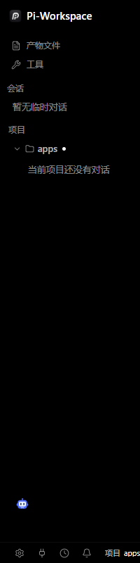

- `产物文件`：Agent 在会话中写入或修改过的文件汇总。
- `工具`：随应用内置的工具包列表。
- `会话`：临时对话（不属于任何项目）。
- `项目`：按项目组织的会话树，`•` 标记表示该项目正在运行任务。

### 10.3 输入框（Composer）


从左到右：

| 控件 | 作用 |
| --- | --- |
| `+` | 添加附件/上下文 |
| `智能体` | 选择当前使用的 Agent 或子智能体 |
| `每次询问` | 权限模式（每次询问工具调用 / 更宽松的模式） |
| `File Explorer` | 选择工具集（本机文件浏览器等） |
| `模型` | 选择模型服务与模型 |
| 折线图标 / 发送箭头 | 发送消息（`Enter` 发送，`Shift+Enter` 换行） |

### 10.4 空态提示


首次进入项目时提示「今天想在 <项目名> 里做点什么?」，输入第一句话即可新建会话。

### 10.5 项目会话页

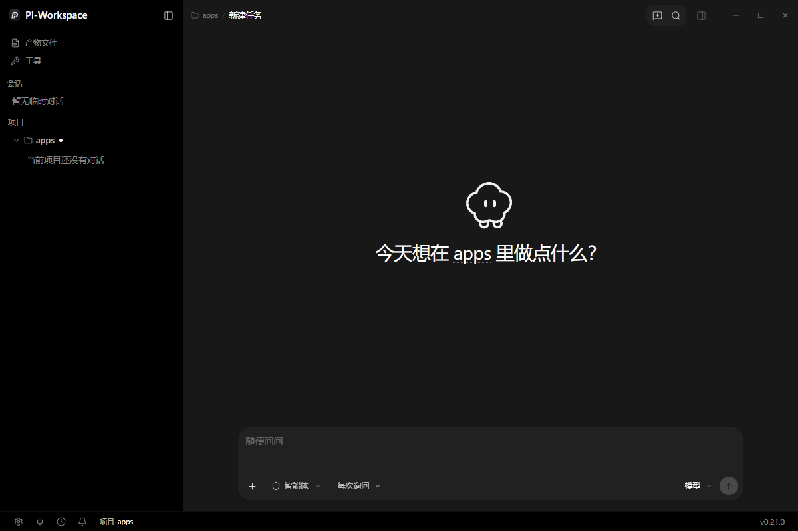

进入项目后，顶部标题为 `<项目名> / 新建任务`，右上角依次是：侧边面板、搜索、切换侧边栏、最小化/最大化/关闭。
左侧项目树会展开当前项目的会话列表。

---

## 11. 数据目录与存储

Pi-Workspace 的持久数据（SQLite、日志、插件状态、Agent 指令）默认位于用户数据根目录，可用环境变量覆盖：

| 环境变量 | 作用 | 优先级 |
| --- | --- | --- |
| `PI_DESKTOP_DATA_DIR` | 指定数据目录（最高优先级） | 1 |
| `PI_DESKTOP_DATA_ROOT` | 指定发布版数据根（其下含 `data`、`userdata` 等） | 2 |
| 默认 | `%LOCALAPPDATA%\\PiWorkspace\\pi` 等用户目录 | 3 |

典型结构（开发 / 发布略有差异，`data-root.ts:61-62`、`data-paths.ts:22/55/66/105`）：

```text
<数据根>/
  data/           SQLite 数据库、会话记录
  userdata/       渲染层用户数据
  agent/AGENTS.md 全局 Agent 指令文件（见 12.7）
  tools/state.json 工具包启用状态（disabled 列表）
```

修改数据目录：**设置 → 常规 → 存储 → 更改路径…**。若该设置项被环境变量接管，
会显示「保存路径由环境变量控制」的提示，此时请改环境变量。

清理缓存：**设置 → 常规 → 存储 → 清理缓存…**，按钮旁会显示可清理的体积（本次快照为 3.8 MiB）。

---

## 12. 设置逐页说明

打开方式：左下角齿轮，或 `Ctrl+, `。设置分四组：`偏好`、`智能体`、`工作区`、`系统`。

### 12.1 常规（偏好 → 常规）

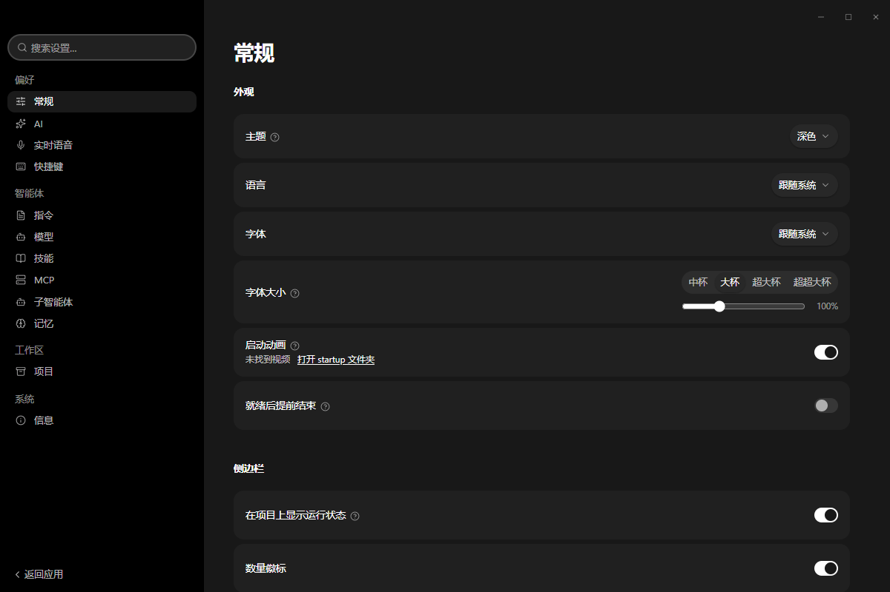

| 分区 | 选项 | 说明 |
| --- | --- | --- |
| 外观 | 主题 | 深色 / 浅色 / 跟随系统 |
| | 语言 | 界面语言，默认「跟随系统」 |
| | 字体 | 界面字体，默认「跟随系统」 |
| | 字体大小 | `中杯`/`大杯`/`超大杯`/`超超大杯` + 滑杆微调（100%） |
| | 启动动画 | 开关；打开后可「打开 startup 文件夹」自定义启动视频 |
| | 就绪后提前结束 | 打开后启动动画在应用就绪时立即结束 |
| 侧边栏 | 在项目上显示运行状态 | 项目节点旁显示运行指示 |
| | 数量徽标、活动流光、会话时间、定时任务、环形右键菜单… | 控制侧边栏各项装饰与功能 |
| 网络 | 代理 | 系统 / 直连 / 自定义 |
| | 网络宽松模式 | 放宽网络限制（内网、自签证书等场景） |
| 存储 | 数据保存路径 | 显示当前数据目录，可「更改路径…」 |
| | 可清理缓存 | 显示可回收体积，可「清理缓存…」 |
| 电源 | 保持电脑唤醒 / 阻止屏幕休眠 | 任务运行期间阻止休眠 |
| | 关闭行为 | `关闭到托盘` / `退出应用` |

### 12.2 全局 AI（偏好 → AI）

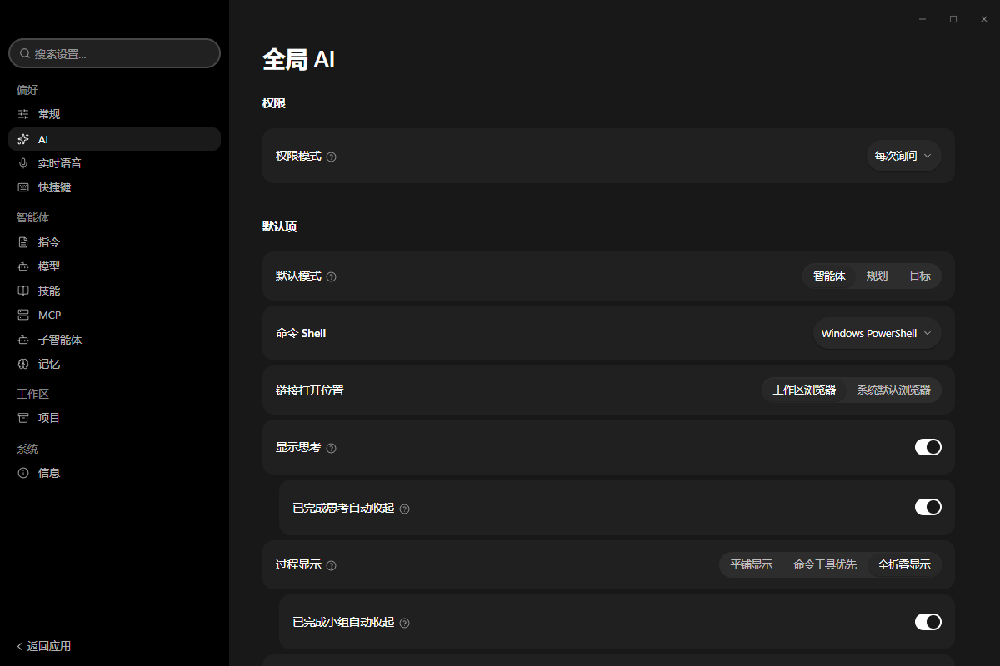

| 选项 | 取值 | 说明 |
| --- | --- | --- |
| 权限模式 | 每次询问 / 更宽松 | 工具调用前的授权策略 |
| 默认模式 | 智能体 / 规划 / 目标 | 新会话默认使用的运行模式 |
| 命令 Shell | Windows PowerShell 等 | Agent 执行命令使用的 shell |
| 链接打开位置 | 工作区浏览器 / 系统默认浏览器 | 会话内点开链接的去向 |
| 显示思考 | 开 / 关 | 是否展示模型思考过程 |
| 已完成思考自动收起 | 开 / 关 | 思考结束后收起 |
| 过程显示 | 平铺显示 / 命令工具优先 / 全折叠显示 | 工具调用过程的呈现方式 |
| 已完成小组自动收起 | 开 / 关 | 工具小组完成后折叠 |

### 12.3 模型（智能体 → 模型）

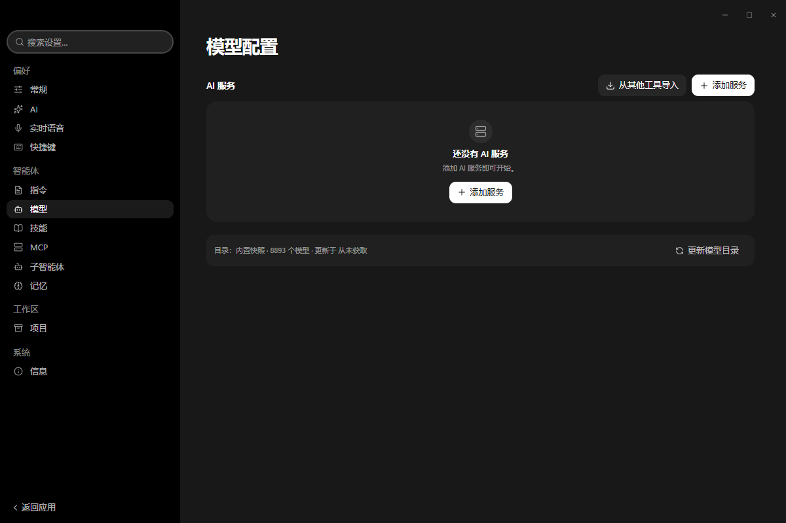

首次使用为空态「还没有 AI 服务」。三条接入路径：

1. `+ 添加服务`：手工填写 OpenAI 兼容的 Base URL、API Key 与模型名（支持本地 Ollama、局域网网关）。
2. `从其他工具导入`：扫描本机已有的工具配置并导入。
3. `更新模型目录`：刷新内置的 models.dev 快照（本次快照 8893 个模型）。

> **必须至少配置一个可用服务，否则发送消息时无法选择模型。**

### 12.4 技能（智能体 → 技能）

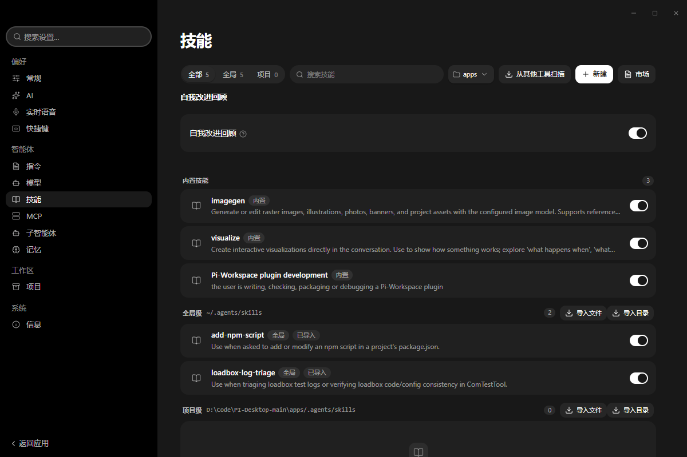

- `自我改进回顾`：让 Agent 在任务后回顾并沉淀技能。
- 三个层级：
  - **内置**（3 个）：`imagen`、`visualize`、`Pi-Workspace plugin development`
  - **全局级** `~/.agents/skills`
  - **项目级** `<项目>/.agents/skills`
- 顶部按钮：`从其他工具扫描`、`+ 新建`、`市场`；每个层级有 `导出文件`/`导入文件`/`导入目录`。
- 每行右侧开关控制该技能是否启用。

### 12.5 MCP（智能体 → MCP）

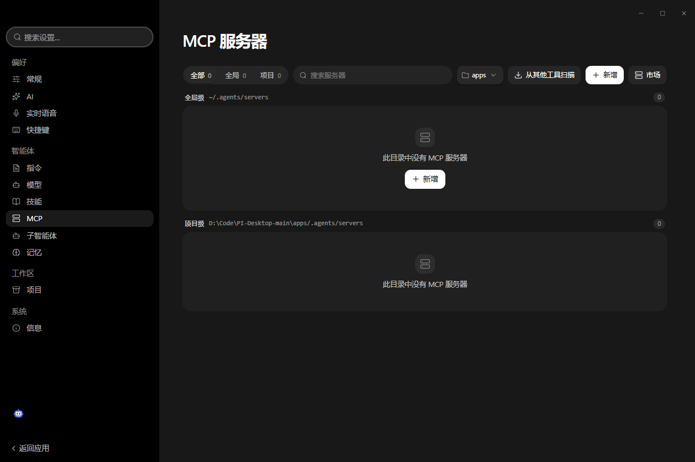

- 全局级目录 `~/.agents/servers`，项目级目录 `<项目>/.agents/servers`。
- 顶部：`从其他工具扫描`、`+ 新增`、`市场`；筛选为 `全部 / 全局 / 项目`。
- 空态提示「此目录中没有 MCP 服务器」。

### 12.6 子智能体（智能体 → 子智能体）

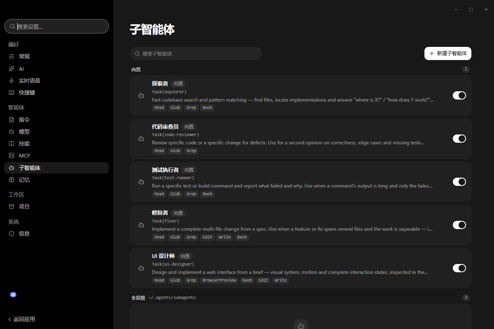

内置 5 个，均可在右侧开关启停：

| 名称 | 标识 | 用途 | 工具 |
| --- | --- | --- | --- |
| 探索者 | `Task(explorer)` | 快速检索代码、定位实现 | Read / Glob / Grep / Bash |
| 代码审查员 | `Task(code-reviewer)` | 复审代码缺陷、边界与测试缺口 | Read / Glob / Grep |
| 测试执行者 | `Task(test-runner)` | 跑测试/构建并解释失败原因 | Read / Glob / Grep / Bash |
| 修复者 | `Task(fixer)` | 按规格实现跨文件改动 | Read / Glob / Grep / Edit / Write / Bash |
| UI 设计师 | `Task(ui-designer)` | 实现 Web 界面与交互状态 | Read / Glob / Grep / BrowserPreview / Bash / Edit / Write |

`+ 新建子智能体` 可自定义提示词与工具白名单。

### 12.7 记忆（智能体 → 记忆）

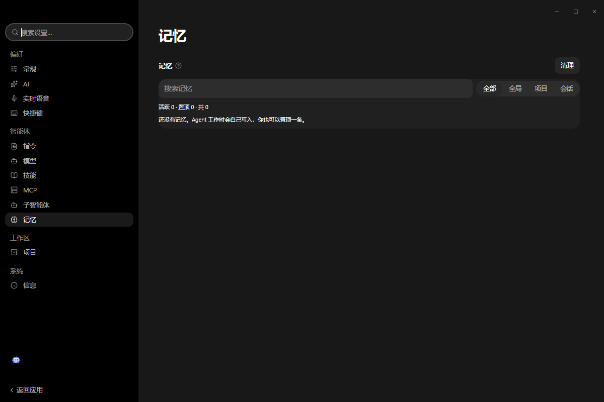

- 顶部统计：`活跃 0 · 置顶 0 · 共 0`，右上角 `清理`。
- 筛选：`全部 / 全局 / 项目 / 会话`，支持搜索。
- 空态提示「还没有记忆。Agent 工作时会自己写入，你也可以置顶一条。」

### 12.8 指令（智能体 → 指令）

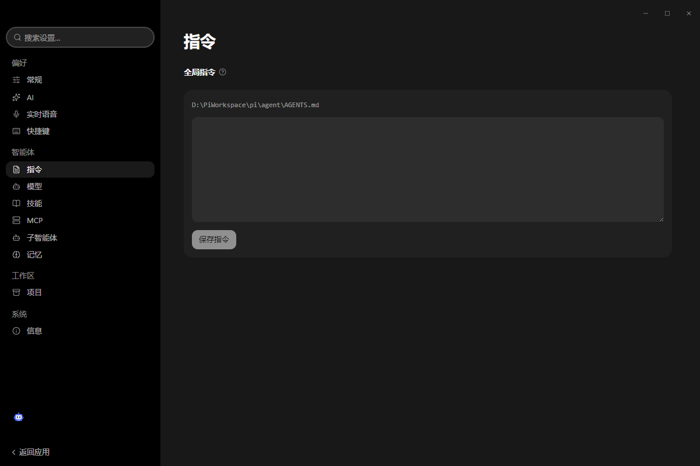

- 全局指令文件路径显示在文本框上方（如 `D:\\PiWorkspace\\pi\\agent\\AGENTS.md`）。
- 在文本框里写长期生效的指令（编码规范、语言偏好、禁改文件等），点 `保存指令` 写入磁盘。
- 项目级指令请在项目根目录放置 `AGENTS.md`。

### 12.9 快捷键（偏好 → 快捷键）

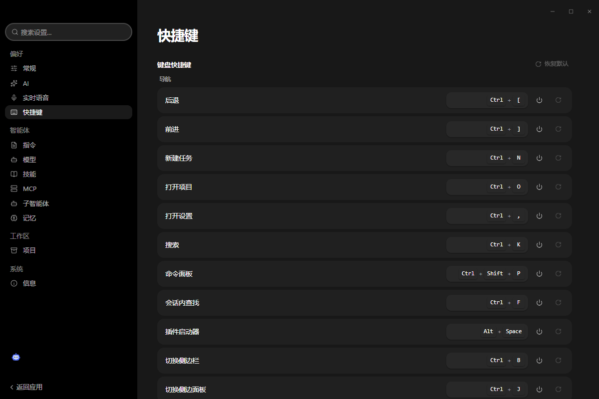

| 动作 | 默认键 |
| --- | --- |
| 后退 | `Ctrl+[` |
| 前进 | `Ctrl+]` |
| 新建任务 | `Ctrl+N` |
| 打开项目 | `Ctrl+O` |
| 打开设置 | `Ctrl+,` |
| 搜索 | `Ctrl+K` |
| 命令面板 | `Ctrl+Shift+P` |
| 会话内查找 | `Ctrl+F` |
| 插件启动器 | `Alt+Space` |
| 切换侧边栏 | `Ctrl+B` |
| 切换侧边面板 | `Ctrl+J` |

每行右侧可清空或录制新按键，页面右上角有「恢复默认」。

### 12.10 项目（工作区 → 项目）

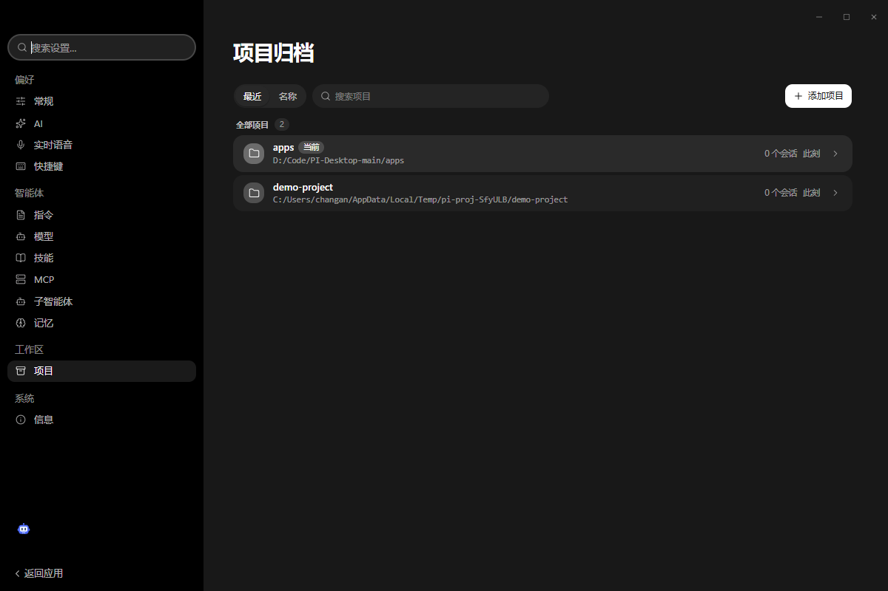

- 排序：`最近` / `名称`；支持搜索项目。
- 统计「全部项目 N」，每行显示项目路径、会话数、最近活动时间。
- 右上角 `+ 添加项目`（等价于左侧栏「打开项目」）。

### 12.11 信息（系统 → 信息）

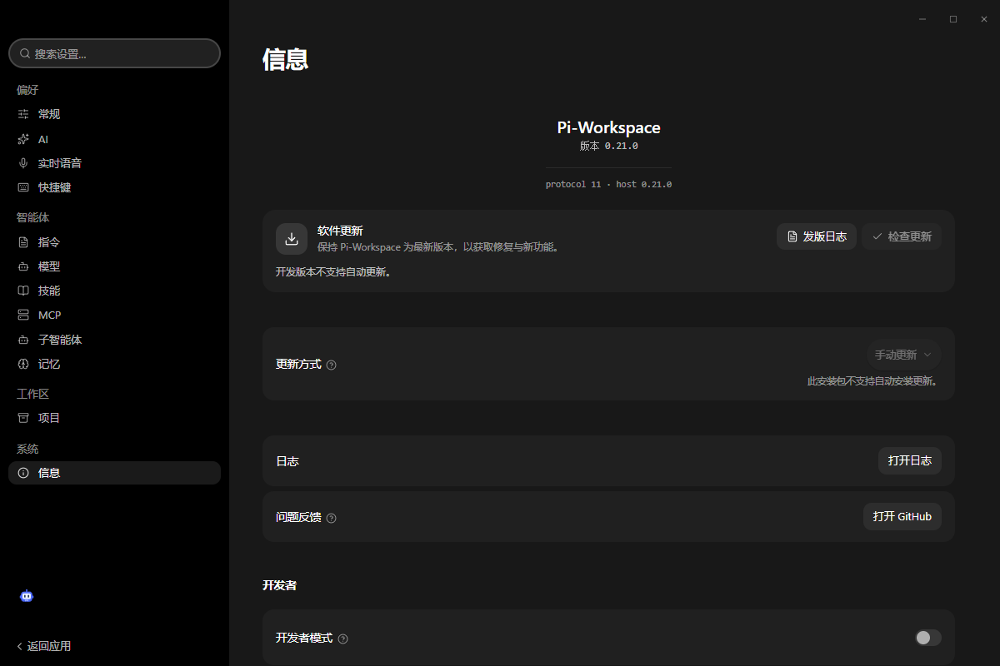

| 项 | 内容 |
| --- | --- |
| 产品 | Pi-Workspace |
| 版本 | 0.21.0（`protocol 11 · host 0.21.0`） |
| 软件更新 | `发布日志`、`检查更新`；开发版本不支持自动更新 |
| 更新方式 | `手动更新`（此安装包不支持自动安装更新） |
| 日志 | `打开日志`：直接打开日志目录，排障首选 |
| 问题反馈 | `打开 GitHub` |
| 开发者模式 | 开关，打开后暴露开发相关入口 |

---

## 13. 其它页面：产物文件 / 工具 / 扩展 / 定时任务

### 13.1 产物文件

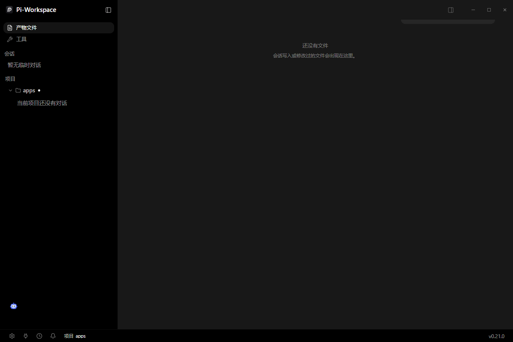

会话中 Agent 写入或修改过的文件会汇总到此页，点击可直接打开。
空态文案：「还没有文件 / 会话写入或修改过的文件会出现在这里。」

### 13.2 工具（工具包 + 能力包）

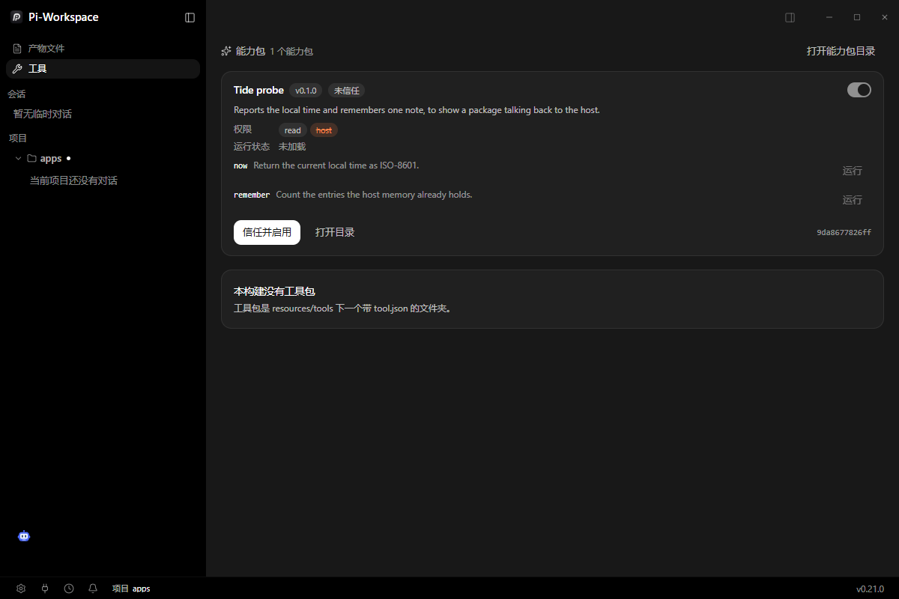

工具页上下两块，**来源不同、生命周期也不同**：

| 区块 | 来源 | 由谁执行 |
| --- | --- | --- |
| 上方：能力包 | `<数据目录>/capabilities/<文件夹>/`，用户自己放进去 | Agent sidecar 进程（不在渲染层，也不在 Electron 主进程） |
| 下方：工具包 | `<安装目录>/resources/tools`，随构建内置 | 声明式元数据，不执行代码 |

截图里上方那张卡片就是随仓库提供的示例能力包 `examples/capabilities/tide-probe`：

- 标题行：名称 `Tide probe` + 版本 `0.1.0` + `未信任` 徽章 + 右侧启用开关。
- `权限`：已授予 `read`，申请中的 `host` 用红框标出——**申请不等于授予**。
- `运行状态`：未加载（未信任的包默认不加载）。
- 每个声明的 action 占一行，右侧有独立 `运行` 按钮；右下角 `信任并启用` 按钮与包摘要（`9da8677826ff…`）。
- 页面右上角 `打开能力包目录` 直接打开 `<数据目录>/capabilities`。

能力包的最小结构：

```text
<数据目录>/capabilities/<文件夹>/
  capability.json
  index.mjs        # 也可以是 index.js / index.cjs，解析顺序 js → mjs → cjs
```

> **踩过的坑（本构建实测）**：`examples/capabilities/tide-probe/capability.json` 里写的是
> `"params": { "note": { "type": "string" } }`，而 host-core 按 `Option<Vec<String>>` 反序列化
> （`crates/host-core/src/capabilities.rs:120`），于是整包报错：
> `capability.json: invalid type: map, expected a sequence at line 14 column 16`，
> 页面上的卡片变红、显示「该能力包无法读取」。`docs/spec/07-plugins/19-capability-packages.md:38`
> 的示例同样是 `"params": {}`，与实现不一致。
> 正确写法是**字符串数组**：`"params": []` 表示无参数，`"params": ["note"]` 表示有一个名为 note 的参数。

能力包 `capability.json` 的正确形态：

```json
{
  "schemaVersion": 1,
  "apiVersion": 1,
  "id": "example.tide-probe",
  "name": "Tide probe",
  "version": "0.1.0",
  "description": "一句话说明这个包干什么。",
  "author": "optional",
  "permissions": ["read", "host"],
  "actions": [
    { "name": "now", "description": "返回当前时间（ISO-8601）。", "params": [] },
    { "name": "remember", "description": "统计记忆条数。", "params": ["note"] }
  ]
}
```

- `id` 是主键；两个文件夹用同一个 id 时，后一个会标记为 `duplicate id`。
- `permissions` 按 `read` → `write` → `net` → `agent` → `host` 递进；未受信任时只保留 `read` / `write`。
- `actions` 是唯一可调用面，模块里注册了但清单没声明的 action 调不到。
- 上限：64 个包，每包 512 个文件、8 MB。
- 入口模块必须 **default export 一个 activate 函数**；只写 `module.exports = {...}` 不会加载。
  包内改任何一个字节都会改变摘要，信任自动撤销并标记为 `modified`。
- 从包里回连宿主只有 5 个方法可用：`memory.recall`、`memory.list`、`memory.stats`、`workspace.get`、`app.health`，且需要 `host` 权限。

下方的工具包来自 `<安装目录>/resources/tools`，每个子目录是一个工具包，需包含 `tool.json`：

```json
{
  "schemaVersion": 1,
  "id": "local.example.package",
  "name": "Example tools",
  "version": "0.1.0",
  "description": "What this package is for, in one line.",
  "author": "optional",
  "tools": [
    { "name": "inspect_widget", "description": "What the tool does, in one line.", "risk": "low" }
  ]
}
```

- `schemaVersion` 必须为 `1`；否则该行会显示为「损坏」而不是被忽略。
- 启用状态保存在 `<数据目录>/tools/state.json` 的 `disabled` 数组里。
- 本构建未内置工具包，因此页面显示「本构建没有工具包」。新增工具包后重启应用即可看到。

### 13.3 扩展（插件）

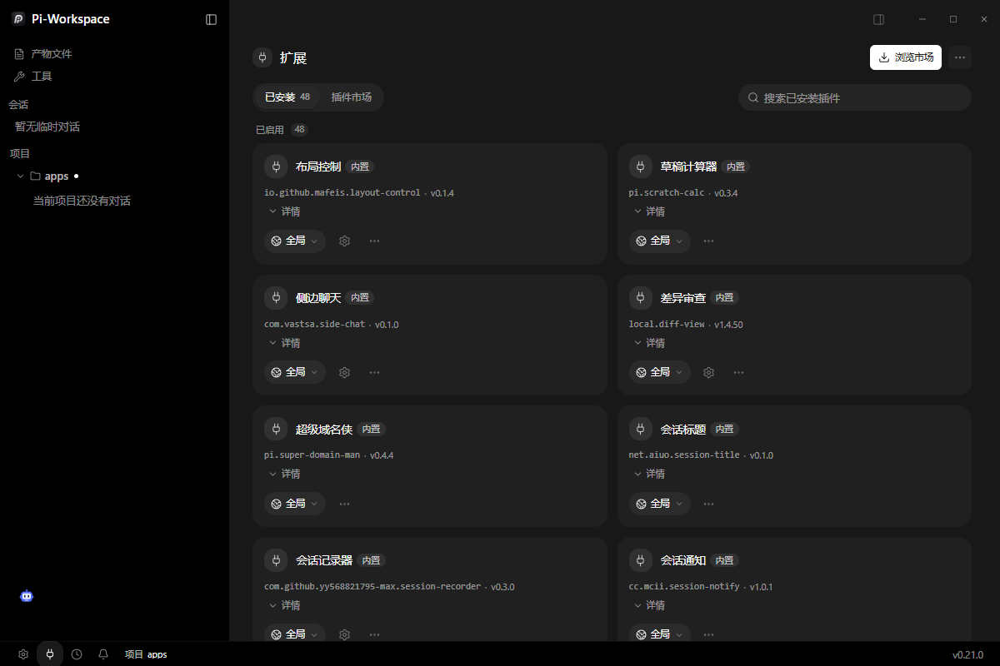

- 顶部：`已安装 48` / `插件市场`，右上角 `浏览市场`。
- 「已启用 48」说明内置插件默认全开。
- 每张卡片：名称 + `内置` 徽章 + 插件 id + 版本 + `详情` 折叠 + 作用域（`全局`）+ 齿轮（设置）+ `⋯`（更多）。
- 搜索框可按名称过滤已安装插件。

### 13.4 定时任务

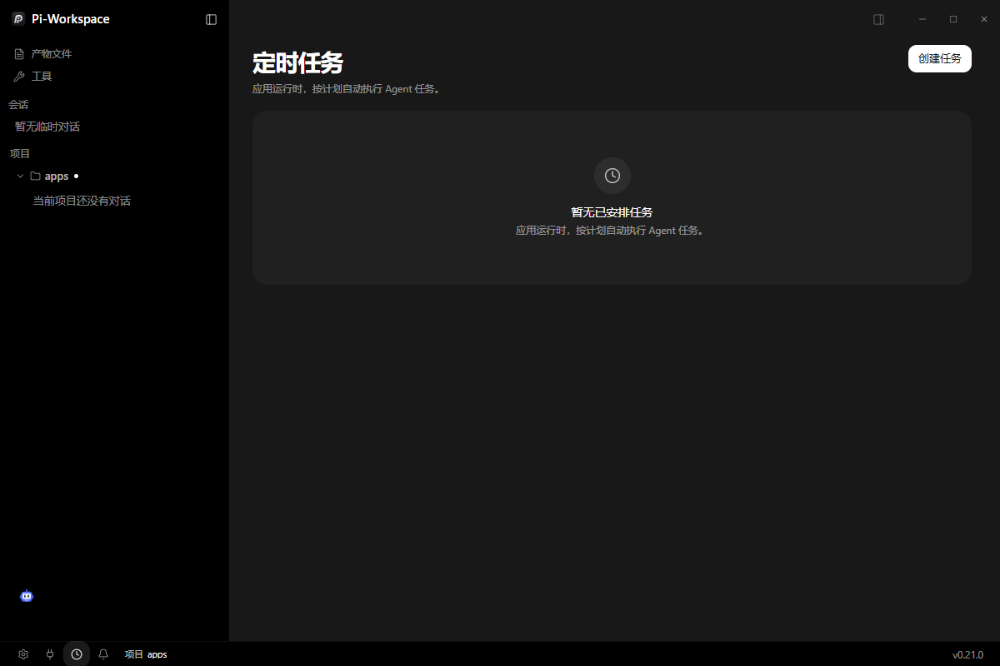

- 页面说明：「应用运行时，按计划自动执行 Agent 任务。」
- 右上角 `创建任务`；空态提示「暂无已安排任务」。
- 注意：定时任务只在应用运行时触发。

---

## 14. 故障排查

| 现象 | 原因 | 处理 |
| --- | --- | --- |
| `Error: no Python 3.12 on PATH` | 打包脚本硬校验 3.12 | 见 5.2 的三种方式 |
| electron-builder 报 `Application entry file "index.js" ... corrupted` | 在仓库根目录执行了 electron-builder | 切到 `apps/desktop` 再执行 |
| 构建时反复下载 Electron | `electron/dist` 缺失 | 设 `ELECTRON_MIRROR`，或给 electron-builder 加 `-c.electronDist=<路径>` |
| 工具页显示红字 `读取能力包失败: method not found: capabilities.list` | **构建顺序**问题：直接手工调 `electron-builder` 而没有先重编 host-core，`resources/bin/pi-desktop-host-core.exe` 还是旧二进制，match 里没有 `capabilities.list` 分支（兜底在 `crates/host-core/src/rpc/mod.rs:6034`） | 走完整链：先 `cargo build --release --locked -p host-core`，再打包；或直接用 `pnpm --filter @pi-workspace/desktop run dist:win`。校验：`win-unpacked\Pi-Workspace.exe` 启动后工具页应显示「能力包 N 个能力包」而不是红字 |
| 能力包卡片变红：`capability.json: invalid type: map, expected a sequence at line …` | `params` 写成了对象 | 改成字符串数组：`"params": []` 或 `"params": ["note"]`，见 13.2 |
| 能力包显示 `未信任` 且运行状态 `未加载` | 首次出现或包内文件被改过，摘要变了 | 点卡片上的 `信任并启用`；改代码后需要重新信任 |
| 发送消息时无法选择模型 | 未配置任何 AI 服务 | 设置 → 模型 → `+ 添加服务` |
| 想彻底重置应用 | 数据目录残留 | 关闭应用后删除第 11 节的数据目录，或改 `PI_DESKTOP_DATA_DIR` 指向新目录 |
| 点「打开手册」没反应或提示找不到 | 本机没有 Markdown 关联程序，或产物里缺 `resources/manual` | 应用会自动改为在资源管理器里选中文件；确认产物 `resources/manual/` 存在，缺了就先 `pnpm stage:manual` 再打包 |
| 改了手册但打出来的包还是旧的 | 只跑了 electron-builder，没走 `stage:manual` | 先 `pnpm stage:manual`（或直接 `pnpm --filter @pi-workspace/desktop run dist:win`），`--check` 可确认是否最新 |

排障第一入口：**设置 → 信息 → `打开日志`**。

---

## 15. 附录：文件清单与校验

### 15.1 版本与校验

```text
版本            0.21.0
Setup exe       约 188 MB   （精确 sha512 / size 见打包目录 latest.yml）
Portable zip    约 259 MB
host-core       约 21 MB    target/release/pi-desktop-host-core.exe
```

> 校验值不要照抄手册：说明书本身被写进了安装包，改一次手册，安装包的尺寸与哈希就会变，
> 任何写死在这里的数字下一轮就会过期。以打包目录里的 `latest.yml`（`sha512` / `size`）与
> 实际文件为准，可用 `Get-FileHash` 或 `certutil -hashfile <文件> SHA512` 复核。

### 15.2 构建命令速查

```bash
git fetch origin main                                   # 1. 拉取最新
pnpm install --frozen-lockfile                          # 2. 依赖
cargo build --release --locked -p host-core             # 3. Rust 宿主
pnpm --filter @pi-workspace/agent-runtime bundle        # 4. Agent 运行时
node scripts/bundle-python-runtime.mjs                  # 5. Python 运行时（需 3.12）
pnpm stage:manual                                       # 6. 暂存说明书与截图
pnpm --filter @pi-workspace/desktop exec electron-vite build   # 6.1 渲染层 + 主进程
pnpm --filter @pi-workspace/desktop run dist:win        # 7. 一键出包（nsis/zip/portable，已内含 stage:manual）
```

### 15.3 截图索引

| 文件 | 内容 |
| --- | --- |
| `shots/01-home.png` | 主界面 |
| `shots/02-sidebar.png` | 左侧栏 |
| `shots/03-composer.png` | 输入框工具栏 |
| `shots/04-empty-state.png` | 空态 |
| `shots/10-project.png` | 项目会话页 |
| `shots/11-settings-general.png` | 设置 · 常规 |
| `shots/12-settings-ai.png` | 设置 · 全局 AI |
| `shots/13-settings-models.png` | 设置 · 模型 |
| `shots/15-settings-skills.png` | 设置 · 技能 |
| `shots/16-settings-mcp.png` | 设置 · MCP |
| `shots/17-settings-subagents.png` | 设置 · 子智能体 |
| `shots/18-settings-memory.png` | 设置 · 记忆 |
| `shots/19-settings-projects.png` | 设置 · 项目 |
| `shots/20-settings-about.png` | 设置 · 信息 |
| `shots/21-settings-instructions.png` | 设置 · 指令 |
| `shots/22-settings-shortcuts.png` | 设置 · 快捷键 |
| `shots/30-artifacts.png` | 产物文件 |
| `shots/31-tools.png` | 工具（能力包 + 工具包） |
| `shots/32-plugins.png` | 扩展（插件） |
| `shots/33-scheduled.png` | 定时任务 |
